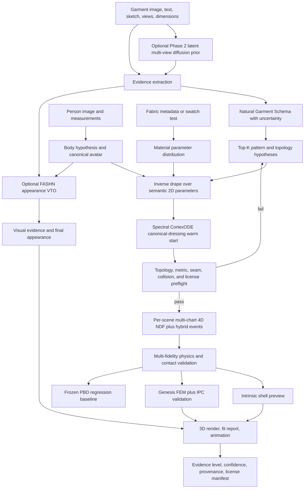

# End-to-End AIGC Fashion Architecture Decision (2026-07-17)

## Status

This is the authoritative architecture decision for the prototype. It refines the
2023 proposal and supersedes earlier assumptions that a single image can determine
one true sewing pattern, that Genesis PBD should be the physical teacher, or that a
cotangent-Laplacian rollout is already a complete cloth model.

## Executive Decision

The broad direction is right, but the current linear route is not the best final
system.

Keep the pattern-first, commercial-safe, physics-aware hybrid. Replace the linear
pipeline with a multi-hypothesis and multi-fidelity system:

1. Separate creative generation, product reconstruction, and fit verification.
2. Convert visual evidence into a structured garment schema with uncertainty.
3. Generate and rank several editable panel-and-seam hypotheses.
4. Condition metric fit on body and garment measurements, not image pixels alone.
5. Preserve the original 2D material metric through dressing and simulation.
6. Use Genesis FEM cloth with IPC as the high-fidelity contact/reference backend.
7. Evolve the intrinsic solver into a fast orthotropic shell solver or accelerator.
8. Retain Genesis PBD and intrinsic v1 as frozen comparison baselines.
9. Keep image VTO as an appearance renderer and evidence source, never as fit truth.
10. Make a scene-optimised, multi-chart 4D NeuralClothSim-style NDF the main
    learned-physics research line after a valid discrete garment hypothesis exists.
11. Use a spectrally bounded CortexODE flow for canonical dressing, with an
    explicit zero-crossing contact/fold event detector that does not remesh cloth.
12. In Phase 2, add only a Dress-1-to-3-style latent multi-view diffusion prior
    to replace the mock image encoder; treat generated views as uncertain evidence.
13. Use Bazin-Pham Fast Marching only to correct inferred closed body/CortexODE
    level sets; preserve all garment panel boundaries, openings, and seam topology.
14. Put geometric learned priors and a mandatory Genesis physics residual inside
    the scene NDF objective. Semantic category and dimensions cannot be the sole
    deformation law.
15. Treat full-stack differentiability as a stage-wise gradient contract. Current
    Genesis IPC, PBD cloth, SPH, and render paths are not all differentiable.

For the intended product, this architecture is stronger than pure 2D VTO, direct
image-to-3D generation, one-shot image-to-pattern regression, pure PBD, or a fully
learned cloth network.

## First Principle: Three Different Products

The original proposal combines three tasks whose outputs have different guarantees.
They should share data contracts, but not claim the same certainty.

| Mode | User promise | Required output | What must not be claimed |
|---|---|---|---|
| Creative design | Plausible, editable fashion concepts | Structured intent, patterns, material mood, renders | Recovered original dimensions or physical constants |
| Product digitization | Best-supported digital-garment hypothesis | Panel/seam graph, dimensions, texture, uncertainty | A unique hidden construction from one view |
| Virtual fitting | Size- and body-conditioned fit prediction | Ease, strain, pressure/contact proxies, 3D drape, visual preview | Centimeter accuracy without metric garment/body evidence |

The artistic fashion-creation loop belongs in the first mode. Pattern recovery and
physics belong in the second and third modes. Aesthetic scoring may rank valid
designs, but it must not repair invalid topology or override physical fit.

## Evidence Levels

A single product image has no absolute scale, does not reveal the back or inside,
and cannot uniquely identify textile parameters. The system therefore assigns an
evidence level to every result.

| Level | Available evidence | Allowed claim |
|---|---|---|
| E0 Concept | Text, sketch, or reference image | Plausible editable design |
| E1 Visual hypothesis | One garment or worn image | Category, visible silhouette, likely topology and material class |
| E2 Metric candidate | E1 plus size chart or one known garment dimension, and body measurements | Body-graded pattern and measurable fit candidate |
| E3 Geometry candidate | At least four garment views plus garment dimensions | Topology-aware digital-twin candidate |
| E4 Calibrated twin | E3 plus fabric specification, swatch tests, or calibrated motion | Calibrated physical garment within reported tolerances |

This follows the evidence in current work: [FIT](https://johannakarras.github.io/FIT/)
shows that appearance VTO tends to hallucinate a neutral fit when measurements and
ill-fit examples are absent; [ReWeaver](https://openaccess.thecvf.com/content/CVPR2026/html/Li_ReWeaver_Towards_Simulation-Ready_and_Topology-Accurate_Garment_Reconstruction_CVPR_2026_paper.html)
uses as few as four views for topology-aware reconstruction; and
[Image2Garment](https://image2garment.github.io/) explicitly describes single-image
material recovery as ill-posed.

## Target Architecture

## Layer Decisions

### 1. Fashion understanding

Use a general VLM to emit a versioned Natural Garment Schema, inspired by
[NGL](https://arxiv.org/abs/2602.20700), rather than asking a model for final mesh
vertices. Each field records `observed`, `occluded`, `inferred`, or `unknown`, plus
a confidence or interval.

The schema contains category, layer, panel inventory, symmetry, neckline, shoulder,
armhole, sleeve, cuff, hem, closure, dart, seam topology, grainline, ease class,
fabric construction, print region, dimensions, and provenance.

Fashion-specific embeddings remain useful for retrieval and style similarity.
[Marqo FashionSigLIP](https://github.com/marqo-ai/marqo-FashionCLIP) is a stronger
commercially permissive retrieval candidate than making the older FashionCLIP
embedding the central reasoning model. Embeddings should retrieve references and
rank style; the structured VLM output should drive pattern hypotheses.

### 2. Pattern generation

The production core is a project-owned template library implemented through the
MIT-licensed [GarmentCode](https://github.com/maria-korosteleva/GarmentCode) model.
Templates encode construction knowledge and body-grading parameters. A common
basic T-shirt fabrication pattern has front/back bodices and one whole sleeve panel
per arm, usually plus a neckband. Each sleeve must expose separate front cap, back
cap, two underarm, and cuff interfaces. GarmentCode internally represents a sleeve
as front/back half panels. Both representations are valid when their interface
mapping is explicit.

Keep fabrication topology separate from simulation decomposition. A solver may
temporarily split a whole sleeve into front/back patches for canonical placement,
but that internal split must map back to the original material panel and must not
be reported as a real seam.

One learned model is not trusted as the only answer. Generate Top-K candidates:

- deterministic category template graded from measurements;
- learned GCD candidate, initially benchmarked through GarmentGPT behind an adapter;
- one or more hidden-topology variants when the back, sleeve, closure, or layering is
  not observed;
- future multi-view candidate from a ReWeaver-compatible provider.

The June 2026 [PatternGSL](https://arxiv.org/abs/2606.24564) representation is a
strong future learned provider because it makes panel geometry, boundary curves,
and stitch topology explicit without a fixed garment template. Keep it in the
research-provider tier until its promised code, data, checkpoints, dependencies,
and commercial terms are available and audited. Its synthesized back view and
predicted scale token are learned priors, not observations or metric anchors.

Normalize all providers to one panel/seam graph. Rank by schema agreement, topology,
seam compatibility, silhouette and landmark reprojection, metric ease, initial
strain, collision, uncertainty, and runtime license clearance.

### 3. Inverse drape

Use the [Dress-1-to-3](https://dress-1-to-3.github.io/) principle: refine a coarse
pattern through rendered evidence and physical drape. Optimize semantic 2D pattern
parameters, canonical panel placement, and bounded material priors. Do not optimize
arbitrary final 3D vertices as a substitute for changing the rest pattern.

For E1 input, inverse drape reduces visual error but does not create metric truth.
For E2 and above, known dimensions anchor scale and make body ease meaningful.

A CortexODE-style neural dynamical system may propose a topology-preserving
continuous deformation for each already sewn candidate. Its spectrally normalised
velocity field must preserve the 2D rest metric and fixed seam graph, expose its
output only as a canonical-dressing warm start, and stop/restart at bracketed
contact events. A completed DOPRI5 call is not an event guarantee.

After preflight, optimise one dedicated multi-chart 4D NDF for each fixed garment,
body, material, motion, and camera scene. The NDF weights encode that scene's
continuous spatio-temporal cloth state; this is not a feed-forward image latent.
An AI-Pontryagin-like controller may optimise bounded semantic pattern and material
controls, but must not optimise arbitrary final vertices as hidden pattern edits.
The detailed decisions are in
[NEURAL_DYNAMICAL_SURFACE_RECONSTRUCTION_2026.md](NEURAL_DYNAMICAL_SURFACE_RECONSTRUCTION_2026.md)
and [NDF_CORTEXODE_CLOTH_ROUTE_AUDIT_2026.md](NDF_CORTEXODE_CLOTH_ROUTE_AUDIT_2026.md).

### 4. Body reconstruction

Use two body routes:

- Measurement-first: generate the canonical body directly with
  [Anny](https://github.com/naver/anny). Its default code is Apache-2.0 and its MPFB2
  assets are CC0; it supports infants through elders. Do not use its optional SMPL-X
  topology in commercial mode.
- Image-first: optionally infer pose and coarse shape with
  [SAM 3D Body](https://github.com/facebookresearch/sam-3d-body), which predicts the
  Apache-2.0 [MHR](https://github.com/facebookresearch/MHR) representation. Retarget
  pose and measurements to the canonical body, and let user measurements override
  monocular shape estimates.

SAM 3D Body uses the custom SAM License rather than Apache-2.0. It grants broad use
and modification rights but includes redistribution, trade-control, termination,
and indemnity terms, so production adoption requires a legal review. MHR itself is
Apache-2.0. The independent
[anthropometric evaluation](https://arxiv.org/abs/2601.06035) also reports
regression-to-the-mean for unusual body shapes. Image HMR is therefore a pose and
shape prior, not a measuring instrument.

For child fitting, direct Anny parameters plus height, chest, waist, shoulder, and
upper-arm measurements remain the safest primary route.

When an image route first produces a closed implicit body rather than an already
audited body mesh, correct its SDF topology before Marching Cubes and require one
closed genus-0 component with `chi=2`. Do not run the same spherical correction on
the garment atlas.

### 5. Material inference

Replace the current dimensionless material scalars with SI-valued parameters and
uncertainty:

- areal density in kg/m2 and thickness in m;
- warp and weft tensile response;
- in-plane shear response;
- Poisson or area response;
- warp and weft bending response;
- damping, body friction, and cloth-cloth friction;
- knit/woven construction, fiber family, and grain direction.

Follow Image2Garment's factorization: infer interpretable composition and fabric
attributes first, then map them to a parameter distribution using an owned or
commercially cleared measurement set. Provide cotton-jersey and other calibrated
presets. E4 adds a simple stretch, bias, bend, or drape swatch test.

### 6. Physics

The physics stack has four roles, not four competing products.

| Backend | Role | Decision |
|---|---|---|
| Genesis PBD cloth | Historical behavior and speed regression | Freeze and retain; never use as teacher truth |
| Genesis `FEM.Cloth` plus IPC | High-fidelity contact and reference trajectories | Make the validation/export backend |
| Intrinsic shell v2 | Interactive preview and differentiable optimization | Keep the research contribution, but replace its current energy model |
| Per-scene multi-chart 4D NDF | Continuous differentiable scene representation and compressed trajectory | Make the main learned-physics research line; optimise per scene and validate contact externally |

The current Genesis repository now exposes a
[Neo-Hookean FEM shell with bending and friction through IPC](https://github.com/Genesis-Embodied-AI/genesis-world/blob/3bceecf59accf4493449a3cdc517a49889a1e5cf/genesis/engine/materials/FEM/cloth.py)
and [runnable cloth examples](https://github.com/Genesis-Embodied-AI/genesis-world/blob/3bceecf59accf4493449a3cdc517a49889a1e5cf/examples/IPC_Solver/ipc_objects_falling.py).
[IPC](https://ipc-sim.github.io/) provides intersection- and inversion-free implicit
time stepping. [C-IPC](https://ipc-sim.github.io/C-IPC/) adds codimensional thickness,
frictional contact, and isotropic or anisotropic strain limits while preserving the
rest state.

Genesis's exposed cloth model is presently isotropic, so it is a much better contact
and high-fidelity baseline than PBD, but it is not yet the complete textile model.
The project should either extend the Genesis/libuipc constitutive layer or keep an
orthotropic project-owned membrane energy while delegating contact to IPC.

Genesis World 1.2.1 is not uniformly differentiable across these paths. MPM,
volumetric FEM, rigid dynamics, and parts of Legacy coupling expose backward
implementations. PBD/SPH gradient hooks are empty, IPC reports no `couple_grad()`,
SAP rejects backward, and the image render path has no verified physics-to-pixel
graph. Every selected path must pass autograd-versus-finite-difference probes.

Intrinsic shell v2 must include:

- the immutable 2D material metric from the sewing pattern;
- orthotropic warp/weft membrane strain and in-plane shear;
- rest-dihedral or discrete-shell bending, not mean-curvature shrink smoothing;
- implicit, variational, or XPBD-style stable integration with unit-tested energies;
- continuous body collision, self-collision, finite thickness, and friction;
- resolution-invariance tests and SI-unit material calibration.

A scene NDF is optimised from shell energy, boundary/motion conditions, image
evidence, and IPC-corrected states. It must use immutable panel material coordinates,
explicit seam maps, and separate physical time from CortexODE dressing pseudo-time.
Its spatial decoder is the cloth/body-anchor E(3)-equivariant field in
[E3_ANCHOR_NEURALCLOTH4D_2026.md](E3_ANCHOR_NEURALCLOTH4D_2026.md): learned paths
emit invariant scalar coefficients, while relative anchors, body normals/motion,
particle/scene messages, tactile shear, gravity, and wind supply typed `1o` bases.
The NDF loss must include a Genesis trajectory or online physics prior in addition
to visual/semantic/metric evidence, and must evaluate velocity and acceleration as
first and second derivatives with respect to physical time. A semantics-only loss
is invalid by construction.
Its hybrid event detector updates contact pairs, fold-graph metadata, adaptive
samples, or loss weights; it must not collapse material edges for ordinary folds.
The backend-independent state machine is implemented in
[`aigc_fashion/dynamic_events.py`](../aigc_fashion/dynamic_events.py). Its Liu
fold-graph, level-set root, and ContourCraft contour contracts are specified in
[Dynamic Cloth Event Handler Design](DYNAMIC_EVENT_HANDLER_2026.md). Geometry
adapters must still provide body-SDF values, VF/EE CCD, DCD contour components,
and DOPRI5 dense-output root refinement.

The exact symmetry replacements, Genesis audit, topology gate, and implemented NDF
objective are in
[Genesis Geometric Differentiable Stack](GENESIS_GEOMETRIC_DIFFERENTIABLE_STACK_2026.md).

Additional learned components may predict a bounded residual, reduced basis,
preconditioner, meta-initialisation, or warm start. Train them with shell energy,
IPC distillation, and measured examples, not only PBD trajectories. Recent work such as
[PhySkin](https://arxiv.org/abs/2603.27013) supports self-supervised reduced-space
acceleration, while [ContourCraft](https://dolorousrtur.github.io/contourcraft/)
shows that contact remains difficult for neural cloth. Learned dynamics therefore
remain downstream of hard contact and energy checks.

The phase-change-memristor NDS result does not change these roles. It accelerates
embedded neural-network evaluation and adaptive ODE step search on custom hardware;
it does not supply sewing topology, a rest metric, body/self-contact broad phase,
or an IPC solve. Software validation must precede any hardware mapping.

### 7. Appearance VTO and rendering

Phase 2 replaces the mock image encoder with one Dress-1-to-3-style latent
multi-view diffusion prior. It emits orbital RGB, normal, mask, visibility, and
confidence pseudo-observations. Multiple stochastic samples estimate disagreement;
the original image and metric measurements remain higher-authority evidence. This
is the only new Phase 2 vision algorithm. Its body conditioning must use Anny or an
audited MHR route rather than inheriting Dress-1-to-3's SMPL-X dependency.

[FASHN VTON v1.5](https://github.com/fashn-AI/fashn-vton-1.5) is the preferred
optional 2D preview because its published code and weights are Apache-2.0 and it
supports flat-lay garment input. It can provide masks, landmarks, occlusion hints,
texture fidelity checks, and a photoreal preview.

Its output must not supply pattern scale, chest ease, sleeve circumference, or
material constants. The physical branch exports fit and strain. The image branch
exports appearance. A final renderer may combine geometry-conditioned depth and
normal maps with the appearance model, but confidence remains attached to the
physical evidence level.

## Why The Alternatives Lose

| Route | Advantage | Decisive weakness for this project |
|---|---|---|
| Pure diffusion VTO | Best immediate photorealism | Hallucinates fit; no editable or manufacturable state |
| Direct image-to-3D mesh | Fast visual asset | Fused, unstructured topology; no true panels, seams, or rest metric |
| One image-to-pattern network | Convenient feed-forward path | Hidden construction and scale remain ambiguous; provider and data terms vary |
| Template library only | Reliable and editable | Limited long-tail fashion coverage without learned semantic candidates |
| Genesis PBD only | Fast and available | Tuned constraints are not calibrated textile constitutive behavior |
| Genesis IPC only | Robust contact and stronger fidelity | Too expensive for every interactive step and currently isotropic |
| One-shot image latent to learned cloth | Potentially very fast | Conflates uncertain visual inference with the scene solution and lacks contact guarantees |
| Scene NDF only | Continuous and compact | Per-scene optimisation is not instant and still needs robust contact verification |
| Proposed hybrid | Editable, measurable, auditable, and accelerable | More engineering, but each uncertainty is explicit and testable |

## Audit Of The Current Prototype

### What is already correct

- Pattern, body, preflight, physics, and rendering have separate modules.
- Commercial-use status is represented in pattern-provider routing.
- SMPL is excluded from the intended production path.
- Strict preflight checks topology, seams, size, strain, collision, and sleeves.
- Historical PBD and intrinsic comparisons have been preserved.

### What is currently wrong

1. The current preflight originally overfit to GarmentCode's six-patch simulation
   representation and rejected a normal whole-sleeve pattern by panel count. It now
   accepts either representation; explicit interface semantics still need to become
   part of the shared schema.
2. The corrected preflight audit still measures a p95 material edge ratio of
   `1.5332`, while the gate is `1.20`.
3. `32.22%` of garment faces still intersect the body before simulation, with
   maximum penetration of `55.78 mm`.
4. The intrinsic v1 implementation initializes structural lengths from dressed 3D
   geometry when an avatar is present, then rebases those lengths again after
   collision prefit. This turns collision-induced distortion into the new rest
   metric and explains the plastic, overly soft appearance.
5. Cotangent-Laplacian smoothing is being used as bending. It is a geometric
   smoothing/shrink operator, not a calibrated textile shell energy relative to
   rest dihedral angles.
6. One scalar stretch stiffness and one scalar bending stiffness cannot represent
   a knitted T-shirt's directional and nonlinear response.
7. There is no robust self-contact, CCD, finite-thickness contact, or coupled
   frictional solve in intrinsic v1.

The strict preflight failure is useful: physics must remain blocked for this
candidate. Tuning stiffness on invalid geometry would hide, not solve, the error.
The current report is
[`outputs/anny_child_vto_preflight_audit_v2/vto_preflight.json`](../outputs/anny_child_vto_preflight_audit_v2/vto_preflight.json).

## Keep, Freeze, Replace

| Component | Action |
|---|---|
| Garment state and semantic panel roles | Keep and extend into Natural Garment Schema |
| License-aware provider routing | Keep |
| Strict VTO preflight | Keep; make mandatory in production |
| Current hand-authored four-panel geometry and placement | Freeze for regression; replace in production |
| Whole-sleeve fabrication topology | Keep; map explicitly to optional split simulation patches |
| SewFormer checkpoint | Research comparison only until license is cleared |
| Anny default body | Keep as measurement-first commercial-safe body |
| Anny Multi-HMR / Anny-Fit | Do not use commercially without separate clearance |
| SAM 3D Body to MHR | Optional image HMR after legal review and measurement override |
| Genesis PBD | Freeze as legacy baseline |
| Intrinsic v1 | Freeze as algorithmic baseline |
| Genesis FEM cloth plus IPC | Add as high-fidelity validation backend |
| Intrinsic shell v2 | Build as the principal research/runtime contribution |
| Per-scene multi-chart 4D NDF | Build as the main learned-physics representation after G0-G4 |
| CortexODE plus hybrid event detector | Keep for canonical dressing and active contact/fold graph updates; never remesh ordinary folds |
| FashionCLIP placeholder | Replace core reasoning with structured VLM; retain embeddings for retrieval |

## Mandatory Stage Gates

| Gate | Required evidence | Pass condition |
|---|---|---|
| G0 Provenance | Code, weights, assets, data, model license manifest | Every runtime artifact cleared for intended use |
| G1 Semantics | Garment schema and evidence states | Category/topology ambiguity retained as Top-K candidates |
| G2 Pattern | Panel/seam graph | Valid panels, complete interfaces, matched seam lengths, required roles |
| G3 Metric fit | Garment and body measurements | Scale anchored; ease and openings inside template/material bounds |
| G4 Canonical dress | Dressed mesh before dynamics | Low strain, closed seams, no body intersections, sleeves cover both arms |
| G5 Physics | Intrinsic and IPC runs | Stable energy, no tunneling, bounded strain, reproducible units |
| G6 Fit validation | Size/body stress matrix | Tight and loose cases remain distinguishable and ordered correctly |
| G7 Appearance | Product texture and person identity | Geometry-independent visual metrics pass without changing fit claims |

## Implementation Sequence

### Phase A: Make one T-shirt structurally true

1. Implement the Natural Garment Schema and evidence levels.
2. Implement a fabrication-faithful T-shirt with complete front/back sleeve-cap,
   underarm, shoulder, side, neckline, cuff, hem, and optional neckband interfaces.
3. Grade it from explicit child body and garment measurements.
4. Implement inverse canonical dressing over semantic 2D parameters.
5. Pass strict preflight without running dynamics.

Exit criteria: all G0-G4 checks pass on small, regular, and oversized T-shirts.

### Phase B: Establish physical truth and comparison

1. Add a Genesis FEM cloth plus IPC exporter/runner/importer.
2. Replace `MaterialSpec` with SI-valued orthotropic parameters and uncertainty.
3. Calibrate at least cotton jersey using documented measurements or swatch tests.
4. Build one comparison harness for frozen PBD, intrinsic v1, IPC, and real video.

Exit criteria: no body/self penetration in the IPC run and material trends are
correct when density, stretch, shear, bending, and friction are varied independently.

### Phase C: Build intrinsic shell v2

1. Preserve the 2D metric without post-dress rebasing.
2. Implement orthotropic membrane, shear, and rest-dihedral bending energies.
3. Couple stable integration to IPC/CCD contact or an equivalent hard contact layer.
4. Add gradient, energy, resolution, timestep, and rigid-motion invariance tests.
5. Benchmark speed and error against the IPC reference.

Exit criteria: materially closer to IPC/real observations than PBD and intrinsic v1,
while providing a measured interactive speed advantage.

### Phase D: Add the scene NDF and visual prior

1. Add Top-K learned pattern providers behind audited adapters.
2. Add image-to-material attribute priors with calibrated uncertainty.
3. Add optional SAM 3D Body to MHR pose recovery after legal review.
4. Add optional FASHN VTO appearance preview.
5. Extend NeuralClothSim into a per-scene multi-chart 4D NDF with hard initial and
   boundary conditions, explicit seam maps, and intrinsic shell energy.
6. Add a spectrally bounded CortexODE canonical-dressing flow and explicit body-SDF,
   vertex-face, edge-edge, and fold-confidence zero-crossing events. Localise each
   event, update the active graph, and restart DOPRI5.
7. Add one Dress-1-to-3-style latent multi-view diffusion prior as the only new
   Phase 2 vision algorithm; optimise pattern and NDF state against confidence-
   weighted pseudo-views rather than predicting an NDF from one image latent.
8. Train optional meta-initialisation or reduced models from shell energy plus IPC
   data only after the per-scene optimiser is valid.

Exit criteria: every learned component can be disabled without breaking the
deterministic physical pipeline, every event is localised without material remeshing,
and every result reports its evidence level and per-scene optimisation cost.

## Final Verdict

The current route is approximately `8/10` at the level of research direction and
`4/10` as the current working implementation. The best route is not to abandon the
intrinsic contribution or Genesis. It is to give them correct roles:

- sewing patterns are the editable source of geometry;
- measurements anchor scale and fit;
- Genesis IPC is the high-fidelity physical reference;
- intrinsic shell v2 is the fast, differentiable, project-owned contribution;
- a dedicated multi-chart 4D NDF is the continuous learned representation of each
  solved scene, not a single-image feed-forward prediction;
- CortexODE and explicit hybrid events initialise dressing and track changing
  contact/fold graphs without changing ordinary cloth topology;
- PBD is the frozen legacy baseline;
- learned models generate hypotheses and acceleration, not unverified truth;
- 2D VTO renders appearance, not physical fit.

This revised architecture keeps the strongest idea in the proposal while removing
the assumptions that caused the damaged sleeves, underarm bulge, penetration, and
overly plastic drape in the current T-shirt experiment.
