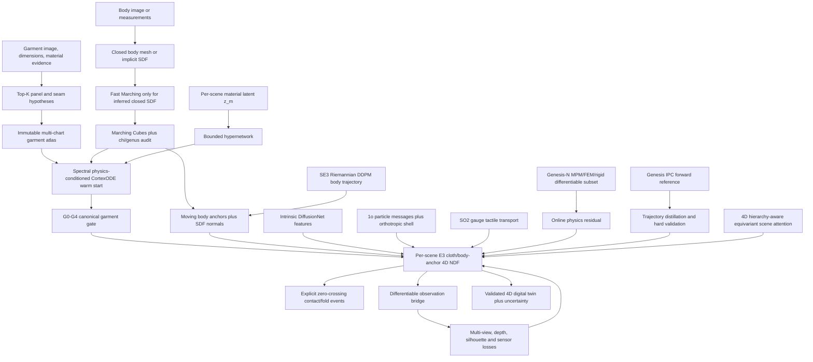

# Genesis Geometric Differentiable Stack (2026-07-17)

## 1. Architecture Decision

Adopt the geometric-learning replacements, but keep a strict boundary between the
existing Genesis World numerical engine and the proposed learned architecture.

Genesis World 1.2.1 publicly implements numerical rigid, MPM, FEM, PBD, SPH,
stable-fluid, SAP, and IPC solvers. Quadrants compiles their kernels and supports
automatic differentiation. The public physics backbone is not presently a
Transformer, PointNet++, VAE, or diffusion model that predicts every next state.
The learned modules below are therefore a project-owned **Genesis-GL extension**,
not a factual description of the current public solver internals.

Use four names consistently:

| Layer | Definition | Responsibility |
|---|---|---|
| Genesis-N | Existing numerical Genesis World | Time integration, constraints, selected gradients |
| Genesis-GL | Geometric learned modules implemented here | Priors, residuals, constitutive latents, acceleration |
| Genesis-O | Differentiable observation bridge | Silhouette, depth, raster and sensor losses |
| NeuralClothSim-NDF | One optimized multi-chart 4D field per scene | Continuous digital-twin representation |

Primary references are the [Genesis World source](https://github.com/Genesis-Embodied-AI/genesis-world),
its [solver architecture](https://genesis-world.readthedocs.io/en/latest/user_guide/theory/solvers_and_coupling.html),
the [differentiation API](https://genesis-world.readthedocs.io/en/v1.2.2/api_reference/differentiation/index.html),
and the [Geometric Deep Learning blueprint](https://arxiv.org/abs/2104.13478).

## 2. Symmetry-Violation Audit And Replacements

### 2.0 Whole-system typed-geometry contract

"Replace raw xyz" applies to all shared and per-scene learned spatial modules and, by project
decision, to the NeuralClothSim 4D field itself. Genesis-N numerical kernels still
need particle/mesh coordinates and rendering still needs camera coordinates. The
legacy coordinate NDF/CortexODE is retained only as an ablation baseline. The
prohibited production path is:

```text
world-space x/y/z components -> ordinary shared MLP -> force/pose/deformation
```

Every shared learned module must instead register its fields and group action in
[`geometric_types.py`](../aigc_fashion/geometric_types.py):

| Physical field | Declared type | Examples |
|---|---|---|
| invariant scalar | `0e` | mass, density, pressure, material code |
| pseudoscalar | `0o` | handedness/chirality when physically required |
| polar vector | `1o` | displacement, velocity, force, SDF-gradient contact normal |
| axial vector | `1e` | angular velocity, torque, winding-derived oriented face normal |
| rigid state | `SE(3)` pose/tangent/cotangent | link pose, twist, wrench |
| tangent direction | SO(2) charge `m` | tactile/shear feature in a local frame |
| surface field | intrinsic scalar | panel feature propagated by `Delta_M` |

Absolute positions may enter an E(3) module only through relative displacement;
absolute times may enter a time-shift-invariant module only through time
differences; link poses use group composition; tangent features use parallel
transport. The executable manifest rejects undeclared Cartesian components and
missing geometric primitives at construction time.

The current pointwise `PhysicsConditionedCortexODE` is retained only as a frozen
per-scene canonical-dressing comparison. The production NeuralClothSim field is
now [`E3AnchorNeuralClothField`](../aigc_fashion/e3_anchor_field.py): its networks
emit invariant scalar coefficients and all 3D output is assembled from relative
cloth/body anchors and typed vectors. `build_whole_system_geometry_manifest()`
registers both the NeuralClothSim NDF and CortexODE scene flow as E(3). CortexODE
predicts invariant scalar coefficients over centered radial and typed SDF-gradient
vector bases; it no longer sends absolute state XYZ through a scalar MLP.

This contract also prevents an over-broad symmetry claim. Gravity is a `1o`
input and must rotate with the scene in a full E(3) test. A fixed floor, camera,
or gravity direction reduces the actual symmetry to a stabilizer subgroup unless
that environment is transformed too. Reflections are valid only when parity-odd
fields, handed seams, and material chirality are typed correctly.

**Backbone router**

| Task | Default | Escalate when needed |
|---|---|---|
| particles with scalars/vectors | EGNN | PaiNN for richer scalar-vector channels; SEGNN/e3nn for higher-order irreps |
| intrinsic panel/soft surface | DiffusionNet | extrinsic irreps only for ambient interactions |
| articulated rigid graph | relative SE(3) message passing | Clifford model for genuinely mixed multivectors |
| irregular fluid/multiphysics | conservative multiscale GNO | higher-order irreps for anisotropic tensor fluxes |
| 4D object graph | spatiotemporal equivariant attention | hierarchy-specific tensor paths after ablation |
| tactile tangent field | gauge-equivariant CNN | higher SO(2) charges for directional harmonics |
| pose trajectory generation | SE(3) Riemannian score model | product manifolds for articulated systems |

The low-order default follows [E(n)-Equivariant Graph Neural Networks](https://proceedings.mlr.press/v139/satorras21a.html)
(Satorras et al., ICML 2021). The Schuett et al. 2021 reference relevant here is
[PaiNN: Equivariant message passing for tensorial properties and molecular spectra](https://proceedings.mlr.press/v139/schutt21a.html)
(ICML 2021), not a NeurIPS paper titled "Equivariant Transformers". The
Geometric Clifford paper is [Ruhe, Brandstetter, and Forre, ICML 2023](https://proceedings.mlr.press/v202/ruhe23a.html),
not ICML 2022. Clifford algebra is selected only when vectors, bivectors,
oriented planes, or rotors must interact; it is not the default replacement for
every scalar/vector graph.

Equivariance is an inductive bias, not a universal generalization guarantee. The
three papers demonstrate benefits on their evaluated domains; Genesis-wide gains
must be established with matched parameters/FLOPs and data. Report data-efficiency
curves at 10/25/50/100 percent, rotated/translated OOD error, unseen body/garment/
material error, remeshing error, rollout stability, and conservation residuals.
No `10x` or `100x` gain is claimed before those measurements exist.

### 2.1 Particle dynamics -> E(3)-equivariant GNN (e3nn / SEGNN)

**Assumed violating architecture**

```text
raw world xyz + velocity + attributes
  -> positional embedding / vanilla attention / PointNet
  -> next xyz or force
```

This representation has no architectural guarantee that translating, rotating,
or reflecting the complete particle system transforms predictions in the same
way. A model can memorize gravity direction, camera axes, or training orientation.
Data augmentation only encourages equivariance; it does not impose it.

**Replacement**

Use an e3nn/SEGNN-style typed feature system:

```text
scalar density/material/pressure: 0e irreps
relative displacement x_j - x_i: 1x1o irrep
velocity/force: 1x1o irrep
messages: tensor products + Clebsch-Gordan paths
outputs: scalar invariants or vector equivariants by declared type
```

`1o` is the polar-vector representation under O(3): it rotates as a vector and
changes sign under inversion. Messages must be functions of relative positions,
not absolute world coordinates. See [SEGNN](https://arxiv.org/abs/2110.02905) and
[EGNN](https://proceedings.mlr.press/v139/satorras21a.html).

The dependency-light first implementation is
[`geometric_cloth_prior.py`](../aigc_fashion/geometric_cloth_prior.py). It realizes
the lowest-order `scalar * 1o vector` path, uses spectrally capped scalar kernels,
and produces pairwise antisymmetric internal forces. Production particle models
may replace that kernel with e3nn tensor products when higher-order irreps are
shown to improve error at acceptable cost.

**Mandatory tests**

- global translation leaves scalar predictions unchanged;
- every `Q in O(3)` gives `f(Qx)=Qf(x)` for vector outputs;
- particle permutation only permutes outputs;
- pairwise internal forces sum to zero;
- performance is compared with the same data, parameters, and neighborhood graph.

### 2.2 Soft-body deformation -> intrinsic mesh CNN (DiffusionNet)

**Assumed violating architecture**

```text
vertex index + raw xyz + fixed one-ring ordering
  -> mesh VAE / Euclidean CNN / per-resolution graph network
  -> deformation
```

This couples learned features to triangulation, vertex density, arbitrary chart
coordinates, and ambient orientation. Re-meshing the same surface can change the
answer even when intrinsic material geometry is unchanged.

**Replacement**

Use the material-surface Laplace-Beltrami operator and learned heat diffusion:

```text
Delta phi_k = -lambda_k phi_k
H_t u = sum_k phi_k exp(-lambda_k t) <phi_k, u>_M
```

The diffusion time is learned per feature channel as in
[DiffusionNet](https://arxiv.org/abs/2012.00888). The implemented spectral layer is
[`intrinsic_diffusion.py`](../aigc_fashion/intrinsic_diffusion.py); tests verify
eigenvector-sign invariance, preservation of constant fields, and gradients to
features and diffusion time.

Important boundary: DiffusionNet propagates **features** intrinsically. It is not
a cloth constitutive law. T-shirt deformation still needs immutable 2D rest
metrics, grain direction, orthotropic membrane/shear, rest-dihedral bending,
seams, finite thickness, friction, and CCD/IPC. The current cotangent smoother
must not be relabeled as physical bending.

**Mandatory tests**

- remeshing/resampling consistency on the same material surface;
- eigenbasis sign and repeated-eigenvalue robustness;
- no dependence on arbitrary UV chart parameterization;
- rigid-motion invariance of scalar features;
- no degradation of shell energy or contact metrics.

### 2.3 Generative dynamics head -> Lie-group diffusion on SE(3)

**Assumed violating architecture**

```text
translation xyz + quaternion components
  -> Euclidean DDPM in R7 or flat latent
  -> normalized quaternion + trajectory
```

Problems include quaternion double cover (`q` and `-q` are the same rotation),
off-manifold Gaussian noise, ad-hoc quaternion normalization, frame-dependent
scores, and Euclidean interpolation that does not follow group geometry.

**Replacement**

Represent object poses by `T in SE(3)`, noise in the tangent algebra `se(3)`, and
compose perturbations through the exponential map:

```text
epsilon ~ tangent noise
T_t = T_0 Exp(sigma(t) epsilon)
relative state = Log(T_condition^-1 T_t)
score = s_theta(relative state, t, context)
```

Global left action is exact:

```text
noise(G T_0, epsilon) = G noise(T_0, epsilon)
```

The implementation in
[`lie_group_diffusion.py`](../aigc_fashion/lie_group_diffusion.py) includes stable
SO(3)/SE(3) exponential and logarithm operations, right perturbation, and a
spectrally bounded body-frame score head. It now also implements a discrete
right-invariant random-walk schedule, separate rotation/translation metric scales,
local transition-score targets, and reverse geodesic steps. Tests verify group
membership, one-step recovery, and global-left equivariance.

This remains a local wrapped-Gaussian approximation, not an exact closed-form
SE(3) heat kernel. Training still needs sequence data, score matching, conditioning,
and full sampling metrics. See
[Riemannian Score-Based Generative Modelling](https://arxiv.org/abs/2202.02763).

### 2.4 Tactile field -> SO(2) gauge-equivariant CNN

**Assumed violating architecture**

```text
tactile image or tangent vector expressed in one arbitrary local frame
  -> planar CNN
  -> contact class / pressure / slip
```

Rotating the tangent basis at one taxel changes feature coordinates even though
the physical tactile field is unchanged. A global image-rotation augmentation
does not handle independent local frame choices over a curved surface.

**Replacement**

Associate each surface point with a tangent frame and transport directional
features across mesh edges using an SO(2) discrete connection. With charge `m`:

```text
z_i' = exp(i m alpha_i) z_i
theta_(j->i)' = theta_(j->i) + alpha_i - alpha_j
transport_(j->i)(z_j) = exp(i m theta_(j->i)) z_j
```

The implemented
[`gauge_tactile.py`](../aigc_fashion/gauge_tactile.py) shares real channel mixing
between real and imaginary components, uses invariant magnitude gates, and tests
equivariance under independent random frame rotations at every node. It follows
the parallel-transport principle in
[Gauge Equivariant Mesh CNNs](https://arxiv.org/abs/2003.05425).

The connection angles must come from audited tangent frames and discrete
Levi-Civita transport. A learned arbitrary angle table would merely move the
coordinate dependence elsewhere.

[`genesis_tactile_adapter.py`](../aigc_fashion/genesis_tactile_adapter.py) now
connects the real Genesis 1.2.1 taxel schema to this layer. Genesis Kinematic and
Proximity taxels return link-local force/torque while probe metadata supplies
link-local positions and normals. The adapter constructs arbitrary tangent frames,
projects shear force into charge-1 complex features, and computes edge transport
by the minimal normal-alignment rotation. Tests rotate every local tangent frame
independently and recover the same physical output vector.

### 2.5 Rigid-body joints -> Lie-group message passing on SE(3)

**Assumed violating architecture**

```text
per-joint world xyz + quaternion + joint ID
  -> separate MLP or flat Transformer token
  -> force/action
```

This breaks global-frame consistency, inherits quaternion discontinuity, and
often allocates joint-specific parameters. Changing robot topology or link count
then changes the parameterization rather than only the graph.

**Replacement**

Use links as nodes, joints as typed edges, and only the right-invariant relative
pose:

```text
T_ij = T_i^-1 T_j
xi_ij = Log(T_ij) in se(3)
m_ij = shared_phi(h_i, h_j, joint_type, xi_ij)
```

The implemented
[`rigid_lie_message_passing.py`](../aigc_fashion/rigid_lie_message_passing.py)
emits a parent body-frame wrench, maps it to the world frame with the coadjoint
action, and applies the exact opposite world wrench to the child. Consequently:

- global left multiplication leaves relative messages invariant;
- output world wrenches transform through the coadjoint representation;
- parent-child action/reaction sums to zero;
- one shared edge network works for any joint count, so parameter count is graph-size independent.

Genesis rigid dynamics and hard joint/contact constraints remain authoritative.
The learned layer supplies a residual, prior, policy encoder, or warm start; it
does not replace constraint stabilization with a neural guess.

### 2.6 Fluid/multiphysics -> conservative multiscale graph neural operator

**Assumed violating architecture**

```text
unordered particle cloud
  -> dense attention or fixed voxel CNN
  -> per-particle next state
```

Dense attention is quadratic and does not enforce conservation. Voxelization
introduces grid orientation and resolution dependence. Independent node updates
can create total mass or momentum.

**Replacement**

Use radius/neighbor graphs at several physical scales and a shared graph integral
kernel. For each undirected edge, infer scalar and vector fluxes from invariant
features and apply them antisymmetrically:

```text
Phi_ij = K_theta(distance, radial_speed, field_mean, |field_difference|, scale)
du_i/dt += Phi_ij       du_j/dt -= Phi_ij
dp_i/dt += Psi_ij       dp_j/dt -= Psi_ij
```

[`graph_neural_operator.py`](../aigc_fashion/graph_neural_operator.py) implements
this `O(E)` multiscale operator. Scalar diffusion uses field differences; vector
flux uses relative velocity and relative direction. Tests verify global scalar
and vector conservation, E(3) equivariance, two-scale aggregation, and gradients
on irregular particles.

For production PDE learning, add boundary normals, material interfaces, kernel
quadrature convergence, adaptive neighborhoods, and rollout stability. Compare
against Genesis MPM/SPH on Reynolds/material regimes held out from training. The
GNO is not accepted merely because its one-step loss is low.

### 2.7 4D scene graph -> spatiotemporal equivariant attention

**Assumed violating architecture**

```text
absolute xyz + absolute frame index + object ID
  -> temporal Transformer
  -> object relation/update
```

Absolute coordinates break E(3); absolute frame numbers break time-translation
consistency; flat attention ignores parent-link-object-contact hierarchy; learned
object IDs do not transfer to new scene compositions.

**Replacement**

Use an object-time graph whose edge types include temporal, parent-child, contact,
and task relations. Attention logits are scalar invariants:

```text
a_ij = softmax_i(q(h_i)^T k(h_j)
                 + b(distance_ij, delta_t, hierarchy_delta, relation_type))
vector_message_ij = a_ij c_ij unit(x_j - x_i)
```

The implementation in
[`spatiotemporal_scene_graph.py`](../aigc_fashion/spatiotemporal_scene_graph.py)
is invariant to global translation, equivariant to O(3) vector transforms,
invariant to global time shifts, hierarchy-aware through shared relation
embeddings, and optionally causal. Attention is normalized per receiving node.

This is an object-level reasoning layer. It should not replace per-triangle cloth
constitutive dynamics or per-particle PDE integration.

## 3. Latent Physics-Conditioned CortexODE

The deformation architecture is:

```text
z_m in R32                           one optimized material latent per scene
H_psi(z_m, material_coordinate)      bounded FiLM hypernetwork
dX/dtau = f_theta^spec(X, tau, ...)  spectrally capped CortexODE
```

[`physics_conditioned_flow.py`](../aigc_fashion/physics_conditioned_flow.py)
implements this contract. The hypernetwork does not emit arbitrary complete
flow weights; gains lie in `(0,1)` and biases are bounded. Every affine path is a
`SpectralLinear`, preserving a testable state-Lipschitz bound.

Keep three times/states separate:

1. CortexODE pseudo-time `tau` produces a canonical-dressing warm start;
2. physical time `t` indexes actual dynamics;
3. NeuralClothSim stores `x(panel, material_coordinate, t)` in one scene-optimized
   multi-chart 4D field.

## 4. Genesis Physics Prior Inside The 4D Cloth Field

Semantic category, measurements, panel lengths, and seam topology determine which
garment hypotheses are admissible. They must not be the sole mechanism deciding
4D deformation.

The production field is no longer a direct `(..., world_xyz) -> R3` decoder.
[`e3_anchor_field.py`](../aigc_fashion/e3_anchor_field.py) constructs a same-panel
canonical cloth reference and lets scalar networks weight only declared `1o`
bases: relative cloth/body anchors, body SDF normals/velocities, gauge-reconstructed
tactile vectors, E(3) particle messages, scene vectors, gravity, and wind. The
complete formula and bridge are specified in
[E3_ANCHOR_NEURALCLOTH4D_2026.md](E3_ANCHOR_NEURALCLOTH4D_2026.md).

The implemented objective in
[`scene_ndf_objective.py`](../aigc_fashion/scene_ndf_objective.py) differentiates
the field with respect to physical time:

```text
v = partial x / partial t
a = partial^2 x / partial t^2
```

and optimizes:

```text
L_NDF = lambda_visual   L_visual_evidence
      + lambda_metric   L_metric_evidence
      + lambda_shell    L_orthotropic_shell
      + lambda_dyn      ||M a - f_internal - f_external||^2
      + lambda_seam     L_seam
      + lambda_contact  L_contact
      + lambda_Gx       ||x_NDF - x_Genesis||^2_confidence
      + lambda_Gv       ||v_NDF - v_Genesis||^2_confidence
      + lambda_Gonline  L_differentiable_Genesis
      + lambda_z        ||z_m||^2
```

Two Genesis prior modes are supported:

- **trajectory distillation**: import accepted FEM/IPC/MPM states as detached
  targets; gradients still flow from the loss into NDF parameters;
- **online differentiable**: consume a residual that retains a verified Genesis
  MPM/FEM/rigid autograd path.

The objective rejects a configuration with no Genesis physics-prior weight. Thus
`semantic + size + length` cannot silently become the deformation model.

Genesis targets do not override the panel rest metric. A forward trajectory is
accepted only after seam, strain, collision, units, timestep, and provenance
gates. PBD remains a frozen comparison, not teacher truth. Volumetric MPM remains
an auxiliary prior unless a shell-equivalence benchmark passes. IPC remains the
strong forward contact validator.

## 5. Static Topology Correction And Dynamic Events

CortexODE uses Bazin-Pham topology-preserving Fast Marching on a discrete SDF,
then Marching Cubes, then the diffeomorphic NODE. The result is checked as one
closed genus-0 component with Euler characteristic `chi=2`.

- [Bazin and Pham 2005](https://doi.org/10.1007/11566489_60)
- [Bazin and Pham 2007](https://pmc.ncbi.nlm.nih.gov/articles/PMC2128043/)
- [CortexODE](https://arxiv.org/abs/2202.08329)

[`topology_correction.py`](../aigc_fashion/topology_correction.py) implements the
mesh audit and backend contract. It allows Fast Marching for an inferred closed
body/cortex-like level set and forbids it for a garment panel atlas.

A T-shirt contains panel boundaries plus neck, waist, and cuff openings. Forcing
genus-0 spherical topology would destroy it. Ordinary folds do not alter material
topology either. Contact and fold-graph births/deaths are handled by
[`dynamic_events.py`](../aigc_fashion/dynamic_events.py); only deliberate cutting,
tearing, fastening, or unfastening may change the material graph.

The audited official CortexODE checkout currently has no explicit repository
license file. The project supplies an in-place adapter but does not vendor its
topology code; commercial deployment needs a legally cleared implementation.

## 6. Current Genesis Differentiability Boundary

The checked-out Genesis World version is `1.2.1`, commit
`3bceecf59accf4493449a3cdc517a49889a1e5cf`.

| Path | Current source evidence | Use now |
|---|---|---|
| MPM rollout | Explicit backward methods and differentiable example | Candidate after directional probe |
| Volumetric FEM | Solver backward methods exist | Candidate after material/control probe |
| Rigid dynamics/contact | Differentiable implementation with mode restrictions | Candidate after selected-path probe |
| Legacy rigid-MPM/FEM coupling | Explicit gradient kernels | Candidate |
| PBD cloth and SPH | Gradient hooks are empty | Forward baseline only |
| IPC | `couple_grad()` states gradients are unsupported | Forward validation/distillation |
| SAP | Explicitly rejects backward | Forward only |
| Pyrender/Nyx/Luisa pixel path | No verified physics-to-pixel autograd chain; raster path copies through NumPy | Final rendering only |
| Sensors | Some return Torch tensors, but ancestry varies | Probe each sensor separately |

[`differentiability_contract.py`](../aigc_fashion/differentiability_contract.py)
compares autograd with central finite differences and refuses to certify stages
that are unsupported or not run. “Quadrants supports autodiff” is necessary but
not sufficient for a full-stack claim.

## 7. Integrated Architecture



## 8. Acceptance Gates

1. **Topology**: closed initialization is connected/manifold/genus-0; garment
   boundaries and seam graph are preserved.
2. **Equivariance**: the complete anchor NDF plus particle, rigid, fluid, tactile,
   and scene modules pass their declared group-action tests.
3. **Conservation**: learned internal edge fluxes pass force, mass, and momentum
   balance tests before rollout training.
4. **Lipschitz**: complete CortexODE RHS bound is logged; all conditioning routes
   remain bounded.
5. **Physics gradient**: material-to-stress, rollout, coupling, and observation
   derivatives agree with finite differences.
6. **Events**: DOPRI5 localizes the first root, applies the event, and restarts;
   gradients are piecewise between discrete events.
7. **Cloth truth**: no increase in strain, seam gaps, body/self intersections, or
   timestep/resolution sensitivity against the same IPC and real-cloth references.
8. **Ablation**: every GL replacement must beat a matched non-equivariant baseline;
   sample-efficiency gains are measured, never assumed.

## 9. Implemented Status

Implemented and unit tested:

- explicit contact/fold/intersection event state machine;
- Fast-Marching topology backend contract and mesh Euler/genus audit;
- exact-cap `SpectralLinear`, 32D scene material latent, bounded hypernetwork, and
  physics-conditioned CortexODE;
- E(3)-equivariant conservative material-edge cloth prior;
- DiffusionNet-style spectral heat layer;
- SO(3)/SE(3) exp/log, Lie-group perturbation, and body-frame score head;
- SO(2) gauge-equivariant parallel-transport tactile layer;
- SE(3) relative-joint message passing with coadjoint action/reaction wrenches;
- conservative multiscale graph neural operator for irregular particles;
- hierarchy-aware spatiotemporal equivariant scene attention;
- E(3)-equivariant multi-chart NeuralCloth4D anchor field with exact initial
  position/velocity constraints and typed vector bases;
- one bridge that combines intrinsic DiffusionNet features, `1o` particle force,
  4D scene attention, SE(3) body anchors, and gauge-free tactile vectors;
- discrete right-invariant SE(3) DDPM schedule, transition score, and reverse step;
- typed-geometry manifest and architecture router that reject shared raw-xyz
  networks while preserving numerical-solver coordinate access;
- whole-system manifest that registers NeuralClothSim as E(3) and confines the
  existing coordinate-based CortexODE to a frozen comparison baseline;
- scene NDF objective that mandates a Genesis physics prior;
- stage-wise autograd versus finite-difference certification.

Still required for a working full simulation:

- connect the unified anchor field to one T-shirt that first passes G0-G4;
- implement orthotropic shell v2 and differentiable robust contact;
- add actual Genesis trajectory export/import and gradient probes;
- implement a custom Quadrants latent-conditioned constitutive hook;
- add a differentiable raster/depth bridge;
- train each learned module and benchmark it against IPC and real T-shirt motion.
- run matched EGNN/PaiNN/SEGNN/Clifford ablations before selecting more expensive
  representations or claiming a whole-system generalization gain.

## 10. Verdict

The replacements are mathematically coherent and now have executable symmetry
contracts. They should augment, not erase, Genesis's numerical physics.

The target stack is:

```text
structured garment topology and material metric
+ intrinsic/equivariant geometric learned priors
+ latent-conditioned spectral CortexODE warm start
+ Genesis-constrained per-scene E(3) cloth/body-anchor 4D NDF
+ project-owned differentiable shell/contact
+ Genesis IPC forward validation
+ differentiable observations
```

This makes geometry, physics, and semantics cooperate without allowing semantics
or image scale to invent the deformation law.
