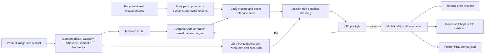

# Mature VTO Preflight For Intrinsic Cloth

## Purpose

The 2023 proposal remains directionally correct, but a garment cannot move safely from a product image directly into cloth physics. Mature virtual try-on systems insert semantic alignment, body-part protection, size handling, and occlusion reasoning before synthesis. Digital-garment systems separately enforce panel topology, seam interfaces, body grading, and manufacturability.

Our working solution combines those two branches. The VTO branch supplies visual evidence. The pattern branch supplies physical geometry. Only a candidate that passes preflight may enter any production physics backend.

## Lessons From Mature VTO

| System | Reusable idea | Use in this project | Production boundary |
|---|---|---|---|
| [FASHN VTON v1.5](https://github.com/fashn-AI/fashn-vton-1.5) | Pixel-space try-on with DWPose, human parsing, flat-lay support, and optional segmentation-free person conditioning | Preferred commercial-capable 2D preview candidate; use output only as soft silhouette/occlusion evidence | Inference code and published model weights are Apache-2.0; retain notices and audit transitive assets |
| [IDM-VTON](https://idm-vton.github.io/) | Garment-agnostic mask, human parsing, DensePose, high/low-level garment features | Define protected body regions and soft silhouette guidance | Code/checkpoints are CC BY-NC-SA 4.0; concept reference only |
| [CatVTON](https://github.com/Zheng-Chong/CatVTON) | Simple person/garment conditioning with automatic cloth masks | Optional fast 2D preview and mask baseline | CC BY-NC-SA 4.0; concept reference only |
| [SAL-VTON](https://openaccess.thecvf.com/content/CVPR2023/html/Yan_Linking_Garment_With_Person_via_Semantically_Associated_Landmarks_for_Virtual_CVPR_2023_paper.html) | Semantically associated garment/person landmarks with visible, occluded, and absent states | Shoulder, armhole, cuff, neckline, and hem correspondence contract | Reimplement the idea; do not vendor unlicensed weights |
| [HR-VITON](https://github.com/sangyun884/HR-VITON) | Joint warping and segmentation-condition generation; reject bad conditions | Pattern candidate reranking and misalignment rejection | CC BY-NC 4.0; concept reference only |
| [Size Does Matter](https://openaccess.thecvf.com/content/ICCV2023/html/Chen_Size_Does_Matter_Size-aware_Virtual_Try-on_via_Clothing-oriented_Transformation_Try-on_ICCV_2023_paper.html) | Clothing landmarks, part-wise transforms, explicit size adjustment | Grade semantic parameters by body measurements instead of scaling the final 3D mesh | Reimplement method-level constraints |
| [VTON-HandFit](https://openaccess.thecvf.com/content/CVPR2025/html/Liang_VTON-HandFit_Virtual_Try-on_for_Arbitrary_Hand_Pose_Guided_by_Hand_CVPR_2025_paper.html) | Explicit hand structure and appearance priors | Protect hands and preserve hand/garment depth order | Research reference |

The 2D VTO result is never treated as metric geometry, garment size, or physical truth. It is a soft source of category, silhouette, semantic landmark, texture, and occlusion evidence.

The preferred implementation order is the project-owned deterministic evidence extractor first, then optional FASHN VTON v1.5 preview/reranking when a person image and GPU are available. IDM-VTON, CatVTON, and HR-VITON remain research comparisons rather than production dependencies.

## Lessons From Digital Garments

| System | Reusable idea | Role here | Production boundary |
|---|---|---|---|
| [GarmentCode](https://github.com/maria-korosteleva/GarmentCode) | Parameterized `Panel`, `Edge`, `Interface`, and `Component` programs driven by body measurements | Preferred commercial-safe template/DSL provider | MIT |
| [SewFormer](https://sewformer.github.io/) and SewFactory | Learned panel and stitch proposal with semantic front/back sleeve patches | Research proposal and compatibility input | Repository has no verified commercial license in this project |
| [AIpparel](https://openaccess.thecvf.com/content/CVPR2025/html/Nakayama_AIpparel_A_Multimodal_Foundation_Model_for_Digital_Garments_CVPR_2025_paper.html) | Multimodal garment tokenization and large digital-garment data | Future candidate generator/reranker | License weights and data separately |
| [ChatGarment](https://openaccess.thecvf.com/content/CVPR2025/html/Bian_ChatGarment_Garment_Estimation_Generation_and_Editing_via_Large_Language_Models_CVPR_2025_paper.html) | VLM predicts and edits structured GarmentCode parameters | Future image-to-semantic-parameter front end | Reimplement against the MIT GarmentCode schema |
| [GarmentCodeData](https://igl.ethz.ch/projects/GarmentCodeData/) | Made-to-measure sampling, XPBD drape, collision and correctness filtering | Training/evaluation design reference | Check dataset terms before training |

Fabrication topology and simulation decomposition must remain distinct. A common
basic T-shirt has front and back bodices, one whole sleeve panel per arm, and often
a neckband. A whole sleeve has distinct front-cap, back-cap, underarm-front,
underarm-back, and cuff interfaces. GarmentCode and SewFactory may represent that
sleeve with front/back patches for easier placement. Preflight accepts either form
when the interface mapping is complete; it must not invent a physical sleeve-top
seam merely to simplify simulation.

## Working Pipeline

## Stage Contracts

### Garment evidence

- Category and confidence.
- Product silhouette features and scale uncertainty.
- Semantic landmarks: shoulders, front/back armholes, cuffs, neckline, hem.
- Landmark state: visible, occluded, absent, or template-inferred.
- Texture image and protected graphic region.

### Body evidence

- Commercial-safe mesh source and pose.
- Chest, waist, shoulder, height, upper-arm, and cuff-arm measurements.
- Torso and arm surface sections.
- Protected face, hair, hands, lower body, and unrelated clothing.

### Pattern candidate

- Template ID and provider license.
- Semantic panel roles and topology.
- Explicit seam interfaces and matched edge lengths.
- Material rest coordinates, grain direction, and fabric family.
- Body-graded semantic parameters, not arbitrary post-mesh scaling.

### Canonical dressing

- Front and back bodices remain distinct shells.
- Front/back sleeve halves wrap the corresponding arm surfaces.
- Paired seam vertices start on a shared 3D interface.
- No physics step is used to repair topology, severe stretch, or body penetration.

## Implemented Preflight Gates

`aigc_fashion/vto_preflight.py` runs before `simulate_intrinsic_cloth` and writes `vto_preflight.json`.

| Check | Current gate |
|---|---:|
| Category/template confidence | at least 0.55, otherwise warning |
| Runtime provider | commercial use must be allowed in strict mode |
| Pattern structure | valid panel geometry, stitch references, and stitch ratios |
| T-shirt topology | front/back body plus whole sleeves or mapped front/back sleeve patches |
| Chest ease | template range, currently 2-20 cm for the knit tee |
| Shoulder grading | garment/avatar ratio 0.92-1.25 |
| Sleeve opening | at least body-derived minimum with wearing ease |
| Armhole | at least body-derived upper-arm minimum |
| Initial material strain | 95th percentile edge ratio at most 1.20 |
| Initial seam closure | 95th percentile gap at most 6 mm |
| Initial body collision | intersecting-face fraction at most 0.5%, penetration at most 3 mm |
| Sleeve coverage | front/back sleeve shell roles and vertices on both arms |

Default mode records failures but preserves old comparison runs. `--strict-preflight` stops before physics when any hard gate fails.

## Current Interpretation

The existing four-panel image-conditioned T-shirt is still available for historical
comparison. Its whole-sleeve panel count is not itself invalid. It still fails
strict preflight because canonical placement produces excessive material strain and
body intersections; its interface semantics are also too implicit for production.
Those failures explain the earlier underarm bulges and sleeve penetration.

The next geometry task is to replace the current hand-authored geometry and dressing
with an interface-complete T-shirt, solve each front/back armhole interface
independently, and rerun preflight. Physics tuning resumes only after that candidate
passes.

The broader 2025-2026 project comparison and revised Top-K architecture decision
are recorded in [VTO_LANDSCAPE_2026.md](VTO_LANDSCAPE_2026.md). The authoritative
end-to-end decision, including the Genesis FEM plus IPC reference and intrinsic
shell v2, is in [END_TO_END_ARCHITECTURE_2026.md](END_TO_END_ARCHITECTURE_2026.md).
The next pattern implementation must preserve multiple hypotheses and uncertainty;
strict preflight should select a candidate rather than merely approve the output of
one heuristic router.
