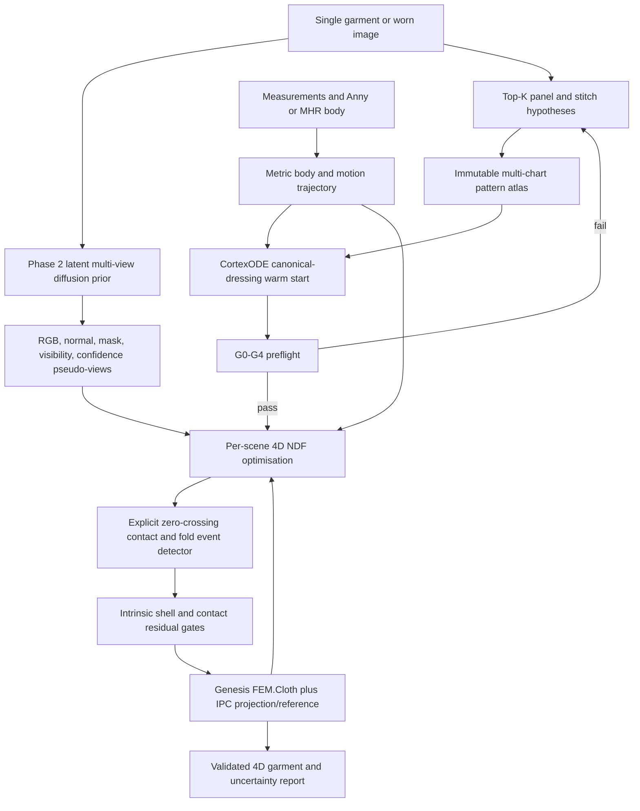

# Per-Scene 4D NDF + CortexODE Cloth Route Audit (2026-07-17)

## Decision

Adopt the proposal conditionally, with one non-negotiable technical mainline:

> For every fully specified garment, avatar, material, motion, and camera scene,
> optimise a dedicated continuous 4D Neural Deformation Field. The weights of
> that NDF are the compressed spatio-temporal simulation state for that scene.

Keep CortexODE as a topology-preserving canonical-dressing and correction flow.
It is not the cloth constitutive model. In Phase 2, the only new vision algorithm
is a Dress-1-to-3-style latent multi-view diffusion prior replacing the mock image
encoder. Generated views are uncertain pseudo-observations, not measured geometry.

The route is applicable to this project after the corrections below. The attached
version is not directly implementable as written because it conflates three
different objects:

1. a scene-specific implicit 4D cloth representation (NeuralClothSim);
2. a point-trajectory ODE that deforms a known mesh (CortexODE);
3. a conventional simulator that supplies contact and constitutive physics.

## Audit Boundary

The attachment names four prototype directories. None of
`cortexode-dhcp-prototype`, `cortexode-dhcp-genesis`,
`cortexode-pet-prototype`, `cortexode-cloth-prototype`, or
`cortexode-garment-prototype` is present in the supplied workspace or attachment.
Only the planning text is available. Their code, checkpoints, logs, seeds, meshes,
and metric implementations therefore cannot be reproduced or accepted as PASS.

The official NeuralClothSim source was checked out separately at commit
`804177be23f4365bf008f01467b870a8e27097f5`. Genesis was audited at commit
`3bceecf59accf4493449a3cdc517a49889a1e5cf`.

## Claim-by-Claim Findings

| Attachment claim | Finding | Project decision |
|---|---|---|
| NeuralClothSim-style NDF plus Kirchhoff-Love shell | Correct research basis | Keep as the primary learned-physics line |
| One NDF forward is the cloth simulation | Incorrect | Training/optimisation solves the scene; forward only queries a solved NDF |
| NDF is CortexODE | Incorrect | NDF directly maps material-space and time coordinates to displacement; it is not inherently an ODE |
| CortexODE supplies cloth physics | Incorrect | Use only for fixed-topology initial dressing or a bounded correction flow |
| Folds require an explicit dynamic event detector | Correct after redefining the state | Detect contact-graph and visible fold-graph birth/death without changing the material mesh |
| SDF zero-crossing is the cleanest event signal | Partly correct | Use body-SDF gap crossings for body contact and primitive CCD gap crossings for self-contact; neither justifies edge collapse |
| Liu 2025 supplies fold node add/remove for simulation | Misread | It is a low-dimensional perception/control graph for robotic garment folding, not mesh remeshing |
| Buonomo 2025 divergence-free flow is a cloth prior | Mostly inapplicable | It preserves volume for closed-shape morphing; an open thin shell needs metric/area and orthotropic strain, not enclosed-volume preservation |
| NVIDIA arXiv:1912.11683 supplies cloth level-set events | Incorrect | That work evolves contours for 2D image segmentation |
| Genesis `FEM.Muscle` is the cloth material | Incorrect | It is an active volumetric tetrahedral muscle model |
| Genesis `requires_grad=True` makes IPC cloth end-to-end differentiable | Not currently exposed | Local `IPCCoupler.couple_grad()` explicitly says IPC gradients are unsupported |
| Genesis MPM should be the final cloth prior | Incorrect for this garment | Current MPM materials are volumetric/particle models, not the required sewn orthotropic shell |
| `T-shirt=4` is a complete production template | Incomplete | Four major panels are valid, but a normal fabrication pattern also needs explicit neckline finishing and all seam interfaces |
| Edge-collapse PASS plus Chamfer reduction proves physics | Incorrect metric | It can improve geometric fit while destroying rest metric, seams, UVs, and material mass |
| `spectral_linear` makes the CortexODE RHS Lipschitz | Correct with a bound audit | Keep it, but include activation Lipschitz constants and every residual/conditioning path in the bound |
| DOPRI5 completing without RK4 fallback proves a valid rollout | Insufficient | It verifies a solver path, not event detection, strain, contact, or integration error at discontinuities |
| Sub-10 ms PCM NDS implies real-time end-to-end cloth | Unsupported | The hardware result accelerates network/ODE evaluation, not per-scene NDF optimisation, sewing, collision search, or IPC |
| Arbitrary SMPL-X is a production body route | License conflict | Keep commercial-safe Anny default topology or audited MHR; SMPL-X needs a commercial licence |

## What NeuralClothSim Actually Provides

[NeuralClothSim](https://arxiv.org/abs/2308.12970) represents one cloth scenario as

```text
x(xi, t) = x_bar(xi) + u(xi, t; Theta_scene)
```

where `xi` is a material/curvilinear coordinate and `Theta_scene` is optimised for
the specified reference surface, material, boundary motion, and external force.
Its SIREN field is input-differentiable so first and second material-coordinate
derivatives can supply nonlinear Kirchhoff-Love membrane and bending strains.
Initial and selected Dirichlet conditions are embedded as hard constraints.

The important operational facts are:

- it overfits an NDF for a target scenario, rather than predicting arbitrary new
  cloth scenes with a single pre-trained forward pass;
- the paper reports about 12 minutes for a short pre-training example and about
  2 minutes for editing, while the later mesh query is fast;
- the main method does not provide robust contact, friction, or self-collision;
- its appendix demonstrates only a soft object-SDF penalty and explicitly says it
  does not guarantee physically realistic contact;
- the public examples mainly use single analytic charts such as a napkin, sleeve,
  or skirt; a sewn T-shirt needs a multi-chart extension.

This is still a strong fit for the research goal. It gives a compact, continuous,
resolution-queryable scene representation and a differentiable place to combine
the project's intrinsic material metric with image evidence.

## Correct Relationship To CortexODE

[CortexODE](https://arxiv.org/abs/2202.08329) integrates point trajectories through
a Lipschitz velocity field from an already valid, topology-corrected initial mesh.
Its cortical application starts from dense 3D MRI evidence and a corrected
genus-zero surface. It neither infers hidden garment panels nor supplies shell
energy.

Use two distinct coordinates:

```text
t    = physical time represented inside the per-scene 4D NDF
tau  = pseudo-time used by CortexODE for canonical dressing/correction
```

For a fixed sewn candidate, the optional initial flow is

```text
dX / d tau = F_phi(X, U, seam_graph, body_sdf, material, tau)
```

It may move vertices but may not change material coordinates `U`, panel topology,
seam correspondence, scale, or material constants. Each numerical step must pass
Jacobian, strain, seam, body-distance, and self-distance checks. The output is only
the initial state for NDF optimisation.

Retain `spectral_linear` in this velocity field. A per-layer spectral cap alone is
not the complete proof: for a composition, an upper bound has the form

```text
Lip(F) <= product_i ||W_i||_2 * product_i Lip(activation_i)
```

For `tanh` or appropriately scaled Softplus, the activation factor is at most one.
For SIREN, `Lip(sin(omega*x)) <= |omega|`, so the usual `omega=30` factors can make
the global bound large even if every linear layer is spectrally normalised. Keep
SIREN for the scene NDF, where smooth second material derivatives are required,
and use a separately bounded network for the CortexODE velocity RHS.

This use preserves the valuable CortexODE idea without pretending that an exact
diffeomorphic flow models thickness, friction, contact, or textile elasticity.

## Correct Relationship To Dress-1-to-3

[Dress-1-to-3](https://arxiv.org/abs/2502.03449) combines a coarse SewFormer pattern,
MagicMan-generated multi-view RGB/normal images, and differentiable CIPC to refine
pattern curves and global physical parameters. Its strongest transferable idea is
not an image latent vector. It is analysis-by-synthesis against several generated
views while the optimisation variables remain sewing-pattern and physical state.

Phase 2 therefore adds one new vision algorithm only:

```text
single image
  -> latent multi-view diffusion prior
  -> K orbital RGB, normal, mask, visibility, and confidence maps
```

These outputs replace the mock encoder and enter the NDF/pattern observation loss.
They do not directly set scale, back topology, material, or body measurements.
The original view receives the highest evidence weight. Synthesised back views
must be labelled `inferred` and down-weighted when samples disagree.

Do not copy Dress-1-to-3's SMPL-X dependency into commercial production. Retarget
the generated-view landmarks and masks to Anny or an audited MHR body. Also do not
assume Genesis supplies Dress-1-to-3's differentiable CIPC backward pass; it does
not currently expose that gradient path.

## Correct Garment NDF Contract

A T-shirt is a panel atlas, not one rectangular grid. Let `p` be panel identity and
`xi=(xi1,xi2)` be immutable 2D material coordinates. The old direct vector decoder
has been replaced by an E(3)-equivariant anchor field:

```text
c_bar(p,xi) = sum_a rho_a(p,xi) C_a, using same-panel material anchors
d_s(p,xi,t) = sum_k scalar_Theta(invariants)_k * typed_1o_basis_k
x_s(p,xi,t) = c_bar(p,xi) + t v_0(p,xi) + I(t) B_p(xi) d_s(p,xi,t)
```

The bases are relative cloth/body anchors, body SDF normals and velocities,
gauge-reconstructed tactile vectors, particle/scene messages, and typed external
fields. `Theta_s` cannot emit raw world-coordinate vector components.

where:

- `Theta_s` is unique to scene `s`;
- `e_p` is a panel/chart embedding;
- `c_bar` is the affine-equivariant canonical placement interpolated from the
  valid 2D-pattern cloth-anchor bank;
- `I(t)` enforces the initial state and initial velocity;
- `B_p` embeds true positional boundary conditions, not all sewing seams;
- `z_body(t)` describes the Anny/MHR pose trajectory;
- `m` contains SI-valued orthotropic material parameters.

The exact implementation and proof are in
[E3_ANCHOR_NEURALCLOTH4D_2026.md](E3_ANCHOR_NEURALCLOTH4D_2026.md).

The scene objective requires all of the following:

```text
L_scene = L_membrane_orthotropic
        + L_shear
        + L_bending_rest_curvature
        + L_inertia_and_external_force
        + L_seam_atlas_compatibility
        + L_body_contact
        + L_self_contact
        + L_multiview_observation
        + L_pattern_and_material_prior
```

Seams need paired material-coordinate maps. Position continuity can be imposed by
an augmented Lagrangian or a shared seam parameterisation. Do not blindly merge
all panel vertices before optimisation: duplicated material coordinates, grain,
UV discontinuities, and sewing correspondence must remain recoverable.

For contact, a soft body-SDF term can help training but is not an acceptance gate.
Use Genesis/libuipc or another IPC implementation as an outer projection/reference
and distil corrected states back into the NDF. Self-contact still needs triangle
and edge primitives; a body SDF cannot detect cloth-cloth intersections.

## Genesis Source Audit

The current Genesis checkout contains a real
[`FEM.Cloth`](../../../work/genesis-world/genesis/engine/materials/FEM/cloth.py)
material managed by the IPC coupler. Therefore `FEM.Muscle` must not be used for
the shirt.

There are three practical caveats:

1. The documentation calls the cloth model `NeoHookeanShell`, but the audited
   [`IPCCoupler`](../../../work/genesis-world/genesis/engine/couplers/ipc_coupler/coupler.py)
   currently instantiates `StrainLimitingBaraffWitkinShell` plus optional
   `DiscreteShellBending`. Benchmark source behavior, not the stale label.
2. The exposed parameters are currently isotropic `E`, `nu`, density, thickness,
   bending stiffness, and friction. They do not directly represent knit warp/weft,
   nonlinear shear, or direction-dependent bending.
3. `IPCCoupler.couple_grad()` is empty and states that IPC gradients are not yet
   supported. `requires_grad=True` in `SimOptions` must not be presented as a
   working end-to-end garment gradient.

Use Genesis FEM cloth plus IPC for forward contact reference, final validation,
and trajectory generation. Optimise the NDF in PyTorch with project-owned shell
energies; use finite differences, implicit differentiation in a separate solver,
or alternating IPC projection until Genesis exposes a tested backward path.

## Hybrid Event Policy

Ordinary dressing, wrinkling, sleeve buckling, folding, and self-contact keep the
material topology fixed. They still require an explicit hybrid event detector
because the active contact and visible-fold graphs change over time.

Use these event functions:

```text
g_body(v, t) = body_sdf(x_v(t), t) - cloth_thickness
g_vf(v, f, t) = distance(vertex, nonadjacent_face) - cloth_thickness
g_ee(e1, e2, t) = distance(nonadjacent_edges) - cloth_thickness
g_fold(c, t) = crease_confidence(c, t) - fold_threshold
```

An enter/exit event occurs at a bracketed zero crossing, with hysteresis to avoid
chatter. Body SDF is appropriate for `g_body`. An open cloth surface does not have
a globally reliable inside/outside sign, so self-contact uses oriented primitive
gaps plus continuous collision detection. DOPRI5 must stop at the first event,
update the active graph and loss/constraint set, then restart integration. A
successful DOPRI5 call without fallback can otherwise step over a narrow event.

The Liu et al. 2025 graph may be useful as an auxiliary visual descriptor of
creases and occlusion during robotic folding. Its nodes may appear and disappear
without changing the garment mesh. Event actions may change active contact pairs,
adaptive NDF samples, local loss weights, or fold-graph metadata. They may not
collapse material edges.

Actual mesh topology events are limited to deliberate tearing, cutting, fastening,
or unfastening. They are out of scope until fixed-topology garments pass all
physics gates. Remove edge collapse from the Phase 0 cloth solver while retaining
the explicit hybrid contact/fold event detector.

### Paper-specific integration

[Liu et al.](https://arxiv.org/abs/2504.20720) define a heterogeneous visual graph
whose region-boundary, crease-endpoint, and sleeve-axis nodes are reconstructed
from keypoints, occlusion segmentation, and tracking. Transfer that graph as
perception metadata and an adaptive-sampling signal. Do not treat its changing
crease graph as a changing sewn mesh.

[Neural ODEs for Image Segmentation with Level Sets](https://arxiv.org/abs/1912.11683)
provides a useful zero-level-set evolution pattern, but it is a 2D segmentation
method. In this project, body SDF and primitive gap functions supply the actual
event fields; the paper does not supply a cloth collision algorithm.

[ContourCraft](https://arxiv.org/abs/2405.09522) contributes the missing recovery
policy for existing cloth intersections. DCD intersections are connected into
open or closed contours. Nodes on open contours and nodes inside outermost closed
contours become non-repulsive, while the squared contour length is reduced using
the quasi-rigid translational part of its gradient. This avoids both permanent
repulsion locking and triangle compression. It complements, rather than replaces,
CCD and IPC.

The implemented state machine and its exact solver contract are documented in
[Dynamic Cloth Event Handler Design](DYNAMIC_EVENT_HANDLER_2026.md).

## Static Topology And Geometric Genesis Priors

CortexODE's Fast Marching step is a pre-deformation correction of a discrete SDF.
It is followed by Marching Cubes and verifies a connected, closed genus-0 surface
with Euler characteristic `chi=2`. It does not detect cloth folds or contact.
Use it for an inferred closed body/cortex-like proxy, never for the T-shirt panel
atlas whose openings, boundaries, and seams are material construction data.

The scene NDF objective now requires a Genesis physics prior in addition to visual,
semantic, and metric evidence. It differentiates the NDF with respect to physical
time, penalizes shell/dynamics/seam/contact residuals, and supports either imported
Genesis trajectory distillation or a verified online Genesis gradient. The
complete symmetry audit and implementation are documented in
[Genesis Geometric Differentiable Stack](GENESIS_GEOMETRIC_DIFFERENTIABLE_STACK_2026.md).

## Revised Stack



The diffusion node is disabled in Phase 0 and Phase 1. Those phases use synthetic
or measured views so vision uncertainty cannot mask physics defects.

## Revised Phases

### Phase 0R: Reproducible NDF foundation

1. Reproduce the official napkin and sleeve NDF without Genesis.
2. Add energy, rigid-motion, initial-condition, and boundary-condition tests.
3. Replace the 8x8 grid and edge collapse with continuous sampling of a fixed mesh.
4. Integrate the implemented hybrid event state machine with body-SDF,
   vertex-face/edge-edge CCD, DCD contour construction, and event-localised
   DOPRI5 restarts.
5. Verify the complete CortexODE RHS Lipschitz bound, not only individual
   `spectral_linear` layers.
6. Record optimisation time separately from NDF query time.

Exit: the same scene converges reproducibly and resampling does not materially
change shell-energy or strain distributions.

### Phase 1: One valid T-shirt scene

1. First make the deterministic T-shirt pass G0-G4 with no dynamics.
2. Extend NDF to front, back, two sleeves, and optional neckband charts.
3. Add explicit seam maps, Anny body SDF, moving body boundaries, and IPC outer
   correction.
4. Optimise one dedicated 4D NDF per garment/body/motion/material scene.
5. Compare against the same Genesis IPC scene, not a fake MPM residual.

Exit: no inverted faces or accepted body/self intersections, bounded material
strain, closed seams, correct sleeve-arm coverage, and lower stored trajectory
size at matched visual/physical error.

### Phase 2: Dress-1-to-3 visual prior

1. Replace the mock image encoder with one latent multi-view diffusion module.
2. Produce multiple stochastic view sets to estimate epistemic disagreement.
3. Optimise Top-K semantic pattern parameters and each candidate's scene NDF
   against weighted pseudo-views.
4. Preserve the original image, user measurements, pattern priors, shell energy,
   and contact gates as higher-authority evidence.

Exit: generated views improve held-out measured-view alignment without increasing
metric error, seam failures, strain, or contact violations.

### Phase 3: Acceleration

First benchmark meta-initialisation, low-rank NDFs, mixed precision, and GPU
optimisation. A phase-change-memristor target is justified only after profiling
shows NDF evaluations dominate total cost and the complete quantised field,
derivatives, adaptive solver, and accuracy gates can be mapped to available
hardware. The Science result alone does not establish this.

## Acceptance Metrics

Chamfer distance is insufficient. Every experiment must report:

- wall time split into pattern inference, per-scene NDF optimisation, NDF query,
  contact correction, and rendering;
- material-space membrane, shear, and bending energies;
- p95/p99 edge and area distortion from the immutable 2D rest state;
- inverted faces, body intersections, self-intersection contours, and minimum
  thickness gap;
- mean/max seam gap and unmatched seam interfaces;
- final residual against the same IPC reference trajectory;
- multi-resolution and timestep consistency;
- uncertainty across pattern candidates and diffusion view samples.

## Final Applicability Verdict

The corrected route is a good research fit and should replace the proposal's
feed-forward `image -> z -> NDF` interpretation. Its defensible novelty is:

```text
structured garment hypotheses
+ Dress-1-to-3 multi-view visual prior
+ scene-optimised multi-chart 4D NDF
+ CortexODE topology-safe initial dressing
+ intrinsic shell and IPC contact verification
```

It is not yet a real-time arbitrary-garment product route. Per-scene optimisation,
multi-chart sewing, robust self-contact, and commercial-safe visual/body model
licensing are the actual blockers. Keeping those blockers explicit preserves the
NeuralClothSim mainline while making it physically and commercially coherent.
