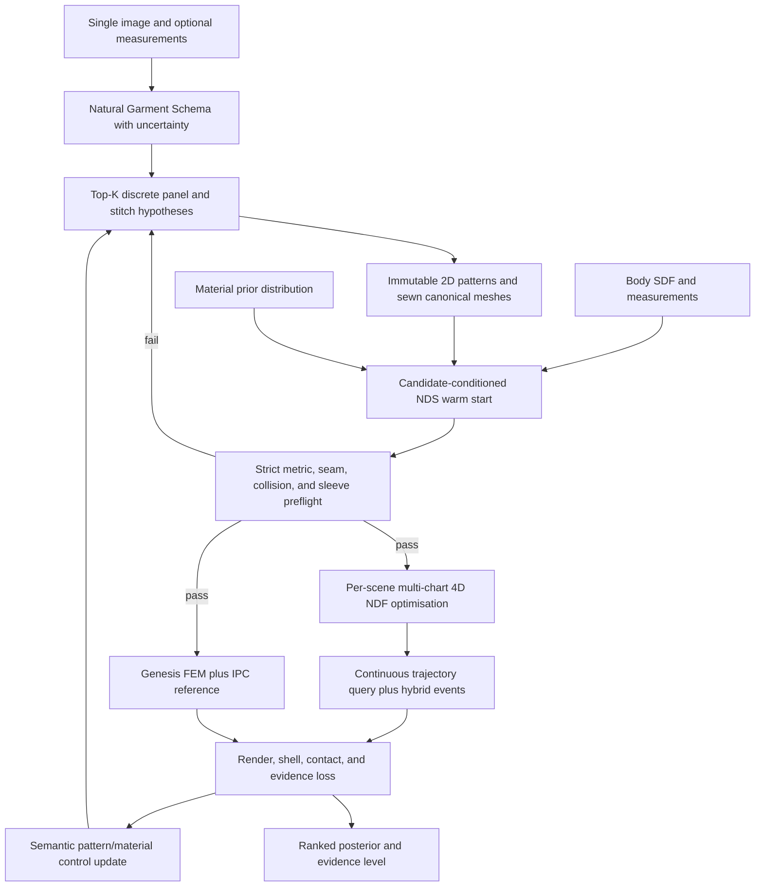

# Neural Dynamical Surface Reconstruction Decision (2026-07-17)

## Decision

Adopt a scene-optimised, multi-chart 4D NeuralClothSim-style Neural Deformation
Field as the primary learned-physics research line. Its weights represent one
fully specified garment/body/material/motion scene, and its fast forward query is
not confused with the scene optimisation that produced those weights.

Separately, adopt a CortexODE-style neural dynamical system only as an optional,
hypothesis-conditioned canonical-dressing and optimization accelerator.

Do not use either learned component as:

- a direct image-to-physical-truth model;
- a replacement for panel and stitch topology prediction;
- a replacement for the immutable 2D pattern metric;
- a replacement for shell constitutive energies, body contact, self-contact, or IPC;
- evidence that hidden geometry, metric scale, or material constants are observable
  from one RGB image.

The correct product claim remains: a single image can produce ranked,
simulation-ready physical hypotheses with calibrated uncertainty. It cannot, in
general, identify one uniquely correct physical garment.

## What The Science Paper Actually Adds

[Cai et al. (Science 2026)](https://www.science.org/doi/10.1126/science.aee6277)
is primarily a hardware paper. It maps adaptive-step neural dynamical system
inference to a 40 nm phase-change-memory chip. The reported contribution is a
2.12 ms single-iteration NDS computation at tolerance `1e-7`, plus large speed and
power gains relative to previous NDS hardware and an A100 comparison. The
[official Peking University description](https://www.ece.pku.edu.cn/info/1007/3181.htm)
also reports real-time white- and gray-matter cortical surface reconstruction.

The paper does not introduce a monocular 3D inference principle and it does not
make an underdetermined inverse problem identifiable. The deployable novelty is
also tied to a fabricated PCM chip and its toolchain; this project does not have
that hardware.

Its cortical workload belongs to the
[CortexODE](https://arxiv.org/abs/2202.08329) family:

1. A full 3D MRI volume is segmented with a 3D U-Net.
2. The white-matter segmentation is converted to a signed distance field.
3. Connectivity and topology correction produce a genus-zero implicit surface.
4. Marching Cubes extracts an already valid initial triangular surface.
5. A Lipschitz-continuous network predicts a velocity for each surface point:

   ```text
   dx_i(tau) / d tau = F_theta(x_i(tau), V)
   ```

6. An ODE solver deforms the initial mesh to white-matter and pial surfaces.

Here `tau` is a continuous deformation coordinate, not necessarily biological
time. The input contains dense, metric 3D evidence around every surface point. It
is not analogous to one front-view garment photograph.

If `F_theta` is Lipschitz in position, the exact initial-value problem has a unique
solution. Distinct trajectories therefore do not meet, giving a diffeomorphic
flow and preserving the input topology. CortexODE still observes numerical
self-intersections with finite-step solvers, which is why integration method and
step size remain important.

## Bibliographic Corrections

The supplied Neural ODE reading list contains one important mismatch:

- [Chen et al., Neural Ordinary Differential Equations](https://arxiv.org/abs/1806.07366)
  is the foundational continuous-depth model.
- DOI [`10.1038/s42256-020-00237-3`](https://www.nature.com/articles/s42256-020-00237-3)
  is Lechner et al., *Neural circuit policies enabling auditable autonomy*. It is
  not a Kidger et al. Neural ODE review.
- The Kidger, Morrill, Foster, and Lyons paper is
  [Neural Controlled Differential Equations for Irregular Time Series](https://arxiv.org/abs/2005.08926),
  NeurIPS 2020. It becomes relevant when a video or sensor stream, rather than one
  image, continuously drives the state.
- [AI Pontryagin](https://www.nature.com/articles/s41467-021-27590-0)
  learns a control signal for a known dynamical system. Its useful analogy here is
  inverse pattern/material control, not hidden topology reconstruction.

## Why One Image Cannot Determine Physical Truth

Let a physical garment state be

```text
G = (T, U, S, X, theta_m, B, C)
```

where `T` is panel/stitch topology, `U` is the metric 2D pattern, `S` is scale,
`X` is the dressed state, `theta_m` is material, `B` is body state, and `C` is
camera/lighting. Rendering is a many-to-one map:

```text
I = Render(G)
```

Several independent ambiguities remain after observing one image:

- Back panels, internal seams, facings, layers, and seam allowances are occluded.
- Perspective does not provide absolute garment or body scale.
- Body shape, pose, garment ease, and pattern dimensions can compensate for one
  another in projection.
- A static equilibrium cannot identify damping at all.
- Many density, bending, stretch, shear, friction, and rest-shape combinations
  produce nearly the same visible drape.
- Texture and illumination can mimic folds and hide real ones.

A neural ODE parameterizes a smooth inverse prior. It does not add a second view,
a ruler, a fabric test, or a motion sequence, so it cannot remove these
ambiguities. A single maximum-likelihood output may look convincing while being
physically wrong.

This is consistent with current garment work. PatternGSL predicts structured
panels and stitches, but its hidden back view and scale are learned priors and its
current evaluation uses static draping with global material settings.
[Image2Garment](https://arxiv.org/abs/2601.09658) improves material priors by
mapping visible fabric attributes to measured parameter distributions, but fixes
friction and damping and explicitly reports that subtle material cues can remain
unobservable from one image.

## Transferable And Non-Transferable Parts

| Cortex/NDS property | Garment use | Boundary |
|---|---|---|
| Continuous diffeomorphic flow | Move an already sewn candidate from canonical placement toward a posed observation | Cannot create panels, holes, openings, or stitches |
| Lipschitz velocity field | Reduce foldovers and mesh self-crossing in an initialization | Does not prevent garment-body intersection or enforce thickness/contact |
| Adaptive integration | Spend more work near difficult deformation regions | Does not solve sparse contact search or IPC linear systems |
| Differentiability | Optimize semantic pattern and bounded material controls | Image loss alone remains non-identifying |
| Compact learned dynamics | Warm-start or precondition intrinsic/IPC solves | Must not overwrite the 2D rest metric |
| Neural CDE | Assimilate irregular video observations | One image supplies no time-varying control path |
| AI Pontryagin | Learn low-cost changes to pattern/material controls | Requires a selected topology and known forward dynamics |
| PCM compute-in-memory | Potential future acceleration of MLP and step search | No evidence it accelerates seam assembly, collision broad phase, or IPC contact |

Cloth contact needs one additional warning. A diffeomorphic flow can preserve the
self-embedding of one surface under exact integration, but it says nothing about
intersection with a separate body surface. It also does not encode a finite cloth
thickness, friction, admissible strain, or shell energy. Contact and material
validity therefore remain explicit hard gates.

## Proposed Integration



### Discrete stage

Topology must be selected before continuous deformation. Use project-owned
GarmentCode programs as the deterministic path and add learned candidates behind
audited adapters. The June 2026
[PatternGSL](https://arxiv.org/abs/2606.24564) representation is a strong research
candidate because it explicitly separates panel geometry, curves, and stitch
topology and covers 2 to 37 panels. It should not yet become a production runtime:
the paper says code and data will be released, the article is CC BY-NC-ND, its
generated back view is a prior, and severe front/back mismatch materially reduces
stitch and simulation success.

PatternGSL also predicts a scale token from a fixed training prior. That is a
plausible E1 scale hypothesis, not a metric E2 anchor. User or product dimensions
must override it.

### Continuous CortexODE dressing stage

For each fixed candidate `k`, preserve material coordinates `U_k` and integrate a
candidate-conditioned pseudo-time field:

```text
dX_k / d tau = v_phys(X_k; U_k, theta_k, B)
              + alpha_k * r_theta(X_k, phi_I, sdf_B, U_k, theta_k, tau)
```

where:

- `v_phys` is a reduced or projected shell/contact descent direction;
- `r_theta` is a bounded learned residual;
- `phi_I` contains image silhouette, landmarks, depth/normal hypotheses, and
  visibility confidence;
- `sdf_B` and its gradient describe the body;
- `alpha_k` is capped or learned with an uncertainty bound.

The CortexODE output is only `X_init`, a warm start. It may not rewrite `U_k`, seam
correspondence, metric scale, or material constants. Every accepted ODE step must
be checked for Jacobian sign, strain, seam error, body distance, self-distance,
and finite thickness. IPC or an equivalent barrier performs the final contact
projection.

The deformation network needs mesh coupling. CortexODE's pointwise network is
conditioned on dense local MRI cubes; cloth should additionally use pattern-space
neighbors, seam neighbors, grain direction, rest dihedrals, and contact features.
A graph/shell operator with spectral normalization is a more appropriate RHS than
an unconstrained per-vertex MLP.

### Inverse control stage

Use an AI-Pontryagin-like controller over semantic, bounded controls rather than
unstructured final vertices:

```text
u_k = (chest_ease, body_length, armhole_depth, sleeve_cap,
       sleeve_width, neckline, material_interval)
```

The differentiable rollout minimizes a multi-evidence objective:

```text
L = L_silhouette + L_landmarks + L_visible_depth
  + lambda_seam * L_seam
  + lambda_metric * E_shell(U_k, X_k, theta_k)
  + lambda_contact * B_IPC(X_k, body)
  + lambda_prior * negative_log_prior(u_k)
```

For E1 inputs, the result remains a posterior over `u_k`. For E2 and above,
measurements constrain scale and ease. A video can add a Neural-CDE branch and is
the first evidence level at which damping and richer dynamics become estimable.

## Relationship To Intrinsic Cloth

The learned-dynamics ideas complement, rather than replace, the intrinsic shell
proposal:

- the intrinsic 2D metric and Laplacian/shell operators supply geometric
  structure to the RHS;
- intrinsic shell v2 supplies physically meaningful membrane, shear, and bending
  energy;
- the per-scene 4D NDF is optimised against those energies and provides the
  continuous stored trajectory;
- the CortexODE flow supplies a fast canonical-state proposal or preconditioner;
- Genesis FEM plus IPC supplies reference trajectories and final contact checks;
- frozen PBD and intrinsic v1 remain comparison baselines.

Do not optimise or meta-initialise the NDF from the current intrinsic v1 rollout.
That rollout rebases
rest lengths after collision prefit and uses cotangent smoothing as bending, so it
would teach the same plastic and overly soft behavior that the project is trying
to remove. Train from validated IPC trajectories, measured fabric examples, and
shell-energy supervision.

## Experiment Before Product Integration

### N0A: Per-scene NDF reproduction

First reproduce NeuralClothSim's fixed-scene napkin and sleeve examples, then add
multi-chart panels and explicit seam maps. Report scene optimisation time and NDF
query time separately. Validate first/second material derivatives, energy,
boundary conditions, resampling consistency, and contact events before adding
image evidence.

### N0B: CortexODE warm-start benchmark

Use only interface-complete T-shirts that already pass G0-G4 without dynamics.
Generate IPC reference trajectories over body size, pose, pattern ease, and at
least three calibrated materials. Compare:

1. deterministic canonical placement;
2. a one-shot displacement network;
3. a Lipschitz NODE warm start;
4. intrinsic shell v2 without the learned residual.

Measure p95 material-edge ratio, inverted faces, body/self intersections, seam
error, IPC Newton iterations, wall time, and final distance to the same converged
IPC state. The NODE is useful only if it introduces no new invalid state and
reduces reference-solver work by a material amount, initially targeted at 30%.

### N1: Single-image inverse drape

For each image, generate at least `K=5` topology/pattern hypotheses. Optimize only
semantic controls and report posterior intervals. Test whether the ground-truth
candidate ranks in Top-1 and Top-K on synthetic held-out data. Include negative
controls in which the same image is paired with different known dimensions; the
system must change metric output rather than treating pixel scale as truth.

### N2: Video-driven physical identification

Add a Neural CDE only when multiple frames are available. Evaluate recovery of
density, bending, shear, stretch, damping, and friction against swatch-calibrated
materials. Report identifiability and confidence separately for each parameter.

## Current Project Gate

The present child T-shirt candidate has p95 initial material-edge ratio `1.5332`
and `32.22%` initial garment/body face intersections. Adding a neural deformation
field now could hide those upstream errors but would not repair the rest pattern
or canonical dressing contract. Implementation should therefore wait until Phase
A produces a T-shirt that passes strict preflight and Phase C supplies the valid
shell/contact objective used to constrain the NDS.

## Final Answer

Can this research help generate a correct physical representation from one image?

- **Yes, partially:** it is well suited to topology-preserving continuous
  deformation, differentiable inverse-drape optimization, and fast warm starts
  after a garment hypothesis has been constructed.
- **No, not uniquely:** it cannot infer hidden discrete construction, absolute
  size, or true dynamic material constants from evidence that the image does not
  contain.

The strongest architecture is therefore `structured Top-K garment hypotheses +
measurement/material priors + scene-optimised 4D NDF + constrained CortexODE
warm start + intrinsic shell/IPC verification`, with evidence levels and
uncertainty preserved end to end.
