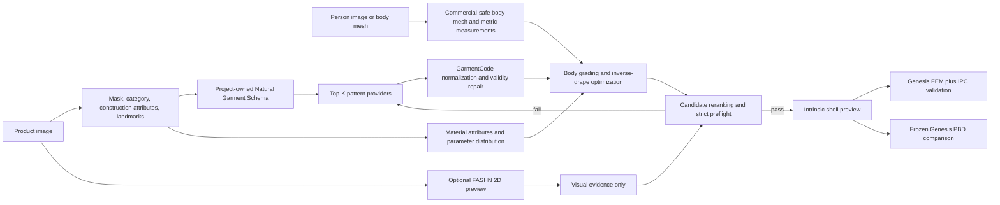

# VTO Landscape And Architecture Decision (2026-07-17)

> The global product, body, material, and physics decision is now recorded in
> [END_TO_END_ARCHITECTURE_2026.md](END_TO_END_ARCHITECTURE_2026.md). This document
> remains the detailed VTO and pattern-provider review.

## Decision

No current VTO project is an end-to-end replacement for this system. Image VTO
models are strongest at photorealistic appearance transfer, while digital-garment
models are strongest at editable panels, seams, sizing, and simulation. The best
architecture for this project is therefore a gated hybrid:

1. A 2D VTO branch produces appearance, silhouette, landmark, and occlusion evidence.
2. A structured reconstruction branch produces several editable sewing-pattern candidates.
3. A material branch estimates fabric attributes and a calibrated distribution of physical parameters.
4. Body measurements and inverse drape refine and rank the pattern candidates.
5. Strict preflight admits only valid, collision-free candidates to multi-fidelity cloth physics.

The current architecture is directionally correct, but the implementation is not
yet the optimum. Its one-shot heuristic template selection and hand-authored
canonical dressing need to become multi-hypothesis structured reconstruction and
inverse-drape fitting.

## What The Projects Actually Solve

| Project | Strongest contribution | What it does not solve for us | Runtime decision |
|---|---|---|---|
| [FASHN VTON v1.5](https://github.com/fashn-AI/fashn-vton-1.5) | Practical maskless 2D try-on from model or flat-lay garment images | Metric size, editable patterns, cloth parameters | Preferred optional 2D preview; Apache-2.0 code and weights, with transitive asset audit |
| [Leffa](https://github.com/franciszzj/Leffa) | Fine texture and logo preservation through learned attention flow | Metric fit and simulation-ready geometry | Comparison preview only until checkpoint, dataset, and third-party terms are cleared |
| [OmniTry](https://github.com/Kunbyte-AI/OmniTry) | Mask-free transfer for garments and other wearable objects | Pattern topology and physical fit; high inference memory | Optional accessory/outfit preview, not the T-shirt geometry core |
| [BooW-VTON](https://openaccess.thecvf.com/content/CVPR2025/html/Zhang_BooW-VTON_Boosting_In-the-Wild_Virtual_Try-On_via_Mask-Free_Pseudo_Data_Training_CVPR_2025_paper.html) | In-the-wild, mask-free VTO and background preservation | Released production implementation and physical garment state | Method reference |
| [FIT](https://johannakarras.github.io/FIT/) / [FitVTON](https://github.com/ZenoNing/FitVTON) | Explicit body/garment size variation and fit-aware evaluation | Continuous centimeter-level ease; FitVTON includes non-commercial Warp and SMPL dependencies | Adopt measurement-conditioned evaluation; do not vendor the full runtime |
| [VTON 360](https://openaccess.thecvf.com/content/CVPR2025/html/He_VTON_360_High-Fidelity_Virtual_Try-On_from_Any_Viewing_Direction_CVPR_2025_paper.html) | Multi-view appearance consistency | Sewing patterns; it relies on SMPL-X normal maps | Research comparison only |
| [GarmentCode](https://github.com/maria-korosteleva/GarmentCode) | MIT parametric panel, edge, interface, and component DSL | Robust single-image recognition by itself | Production pattern kernel and deterministic fallback |
| [ChatGarment](https://github.com/biansy000/ChatGarment) | Image/text to editable GarmentCode and semantic editing | Guaranteed geometric validity and audited transitive model/data terms | Optional candidate provider after dependency audit |
| [AIpparel](https://huggingface.co/georgeNakayama/AIpparel) | Multimodal sewing-pattern tokenization and generation | Physical material estimation and guaranteed fit | Optional candidate provider; MIT model card, but audit base model/data chain |
| [GarmentGPT](https://github.com/ChimerAI-MMLab/Garment-GPT) | Single-image generation of panels, curves, placement, and stitches in GCD JSON | Production maturity, candidate calibration, and body-specific fit | First learned provider to benchmark behind an adapter; Apache-2.0 code/weights |
| [NGL-Prompter](https://arxiv.org/abs/2602.20700) | Natural Garment Language between image understanding and deterministic GarmentCode | Commercial release; announced code/data are research use | Reimplement the intermediate-language idea in a project-owned schema |
| [PatternGSL](https://arxiv.org/abs/2606.24564) | Template-free language with panel boundaries, seams, and explicit stitch topology | Repository and licensing are not released as of this decision | Future schema/provider; do not block current implementation on it |
| [DressWild](https://dresswild.github.io/) | Pose-normalized, feed-forward single-image sewing-pattern reconstruction | Released/audited production runtime | Architecture and evaluation reference |
| [Dress-1-to-3](https://dress-1-to-3.github.io/) | Multi-view diffusion plus differentiable simulation to refine coarse patterns and physical parameters | A released commercial-safe dependency and isolated flat-lay product input | Reimplement its inverse-drape optimization principle |
| [DMap](https://github.com/liren2515/DMap) | Pattern-coordinate mapping from a single view | Clear repository license and body-model independence | Research comparison only |
| [ReWeaver](https://openaccess.thecvf.com/content/CVPR2026/html/Li_ReWeaver_Towards_Simulation-Ready_and_Topology-Accurate_Garment_Reconstruction_CVPR_2026_paper.html) | Topology-accurate panels and seams from as few as four views | Single-image baseline and currently released production code | Best future multi-view capture branch |
| [Image2Garment](https://image2garment.github.io/) | Image to material composition, fabric attributes, and simulator parameters | Released code/data and certainty from one ambiguous image | Reimplement as an uncertainty-aware material estimator |

## Why A Single 2D VTO Model Is Not Enough

FIT explicitly targets a known failure of appearance VTO: most training sets omit
bad-fit examples, so generated garments tend toward a visually plausible neutral
fit. This makes a 2D preview useful as evidence, but unsafe as the source of chest
ease, sleeve circumference, pattern scale, or physical behavior.

Conversely, direct image-to-pattern regression is also insufficient. NGL-Prompter
reports that VLMs describe garment construction more reliably than they regress
raw GarmentCode parameters. PatternGSL and GarmentGPT improve the output language,
but any single-view reconstruction remains ambiguous about hidden back panels,
seam placement, material composition, and real-world dimensions.

The system must preserve uncertainty instead of collapsing these ambiguities into
one garment before simulation.

## Revised Working Solution

### 1. Natural Garment Schema

Do not ask a model to emit final mesh vertices. First emit a versioned semantic
record containing category, layer, panel inventory, symmetry, neckline, shoulder,
armhole, sleeve, cuff, hem, closure, dart, seam topology, ease class, grainline,
material attributes, print region, evidence state, and confidence.

Every field distinguishes `observed`, `occluded`, `inferred`, and `unknown`.
Unknown dimensions remain intervals or priors rather than invented exact values.

### 2. Top-K Pattern Candidates

Generate at least three candidates:

- A deterministic GarmentCode template graded to body measurements.
- A learned GCD candidate from GarmentGPT or another cleared provider.
- A topology variant for ambiguous hidden construction.

Normalize every provider into one GarmentCode-compatible panel/seam graph. Reject
invalid stitch references, unmatched interfaces, missing sleeve halves, inverted
panels, and implausible edge-length ratios before meshing.

### 3. Candidate Fitting And Ranking

Rank candidates with a joint objective rather than a single classifier score:

`topology validity + silhouette reprojection + landmark reprojection + metric ease + seam compatibility + canonical collision + material strain + provider clearance`

Use inverse drape to optimize semantic pattern parameters, panel placement, and a
bounded material prior. Never optimize arbitrary final 3D vertices as a substitute
for correcting the 2D rest pattern.

### 4. Material Inference

Factor the prediction into interpretable attributes first: fiber family, knit or
woven construction, areal density range, thickness, stretch by grain direction,
bending class, shear class, and damping class. Map those attributes to simulator
parameters using measured swatches or an owned calibration set.

A single product photo cannot identify unique physical constants. The runtime must
carry confidence intervals and expose a material preset override. Visual folds may
rerank a prior, but must not silently produce overconfident stiffness values.

### 5. Fit-Aware Evaluation

Add tests inspired by FIT, but keep centimeter-level internal measurements:

- same body with XS through 3XL garment measurements;
- same pattern on multiple body shapes;
- deliberately too-small sleeves and armholes;
- loose, regular, and close-fit ease targets;
- crossed-arm and lowered-arm occlusion cases;
- flat-lay, model-worn, front-only, and four-view garment inputs;
- texture/logo preservation scored separately from physical fit.

## Assessment Of The Current Prototype

| Area | Current state | Assessment |
|---|---|---|
| Overall architecture | Separate pattern, body, preflight, intrinsic physics, and Genesis baseline | Correct direction, about 8/10 after the multi-fidelity revision |
| Product-image understanding | Threshold silhouette plus prompt rules | Prototype only |
| Pattern inference | One routed template; SewFormer proposal can fall back to four panels | Not sufficient |
| Topology validation | Explicit seam checks plus whole/split sleeve alternatives | Correct direction; finish named interface validation |
| Body fit | Metric body checks but hand-authored canonical placement | Needs inverse-drape optimization |
| Material | Prompt/default dimensionless parameters | Major source of the overly soft behavior; replace with SI-valued orthotropic parameters |
| Physics | Cotangent smoothing, edge projection, and collision projection | Experimental v1 only; preserve for comparison, add Genesis FEM plus IPC reference and intrinsic shell v2 |
| Physics admission | Strict strain, seam, collision, and sleeve gates | Correct architecture; current garment fails them |
| Commercial boundary | License-aware provider checks and SMPL exclusion | Strong, but every model must include weights/data/dependency audit |

The current implementation is approximately 4/10 as a production garment
reconstructor because its present T-shirt candidate fails strict preflight. Physics
tuning is not the next corrective step. The next step is the structured Top-K
GarmentCode candidate stage, starting with a fabrication-faithful T-shirt whose
whole or split sleeve representation has explicit front/back cap and underarm
interfaces, plus the project-owned Natural Garment Schema.

## Implementation Order

1. Define and validate the Natural Garment Schema with evidence states and uncertainty.
2. Replace one-shot routing with Top-K candidates and a common provider adapter.
3. Implement the interface-complete, fabrication-faithful T-shirt as the deterministic candidate.
4. Add silhouette/landmark reprojection and inverse-drape parameter optimization.
5. Benchmark GarmentGPT as an optional learned candidate provider.
6. Add SI-valued orthotropic material priors and measured-parameter calibration.
7. Add Genesis FEM cloth plus IPC as the high-fidelity validation backend.
8. Rebuild the intrinsic method as an orthotropic shell solver/accelerator; do not train only on PBD.
9. Integrate FASHN only as optional 2D preview/evidence.
10. Build FIT-style size stress tests and a four-view ReWeaver-compatible capture path.
